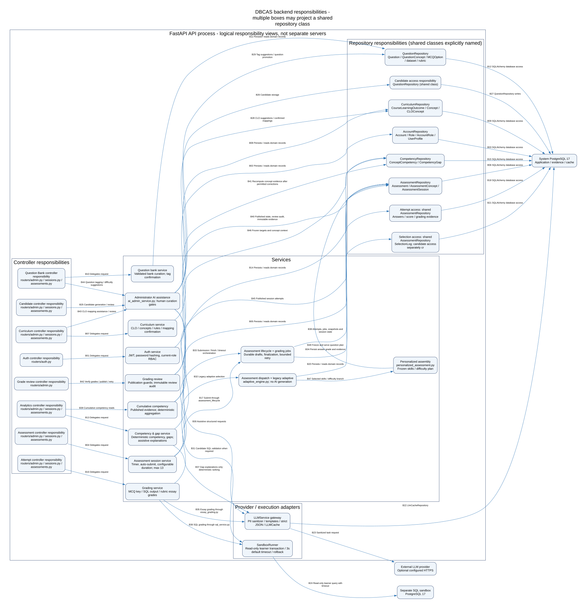

# Kiến trúc và hợp đồng API DBCAS

## Thành phần và luồng dữ liệu

Stack kế thừa: FastAPI/Python 3.13, SQLAlchemy/psycopg, PostgreSQL 17; React/Vite
do nhóm frontend phụ trách. Backend là ứng dụng module hóa, chưa cần microservice.
Worker chấm bài tách vòng xử lý khỏi HTTP, dùng bảng `grading_job` bền vững.



Nguồn có thể sửa và render: [components.dot](diagrams/components.dot),
[containers.dot](diagrams/containers.dot), [lifecycle](diagrams/assessment-lifecycle.dot).
Các hình hiện có mô tả baseline, nhánh DN bổ sung refresh và mode sandbox tạm ở task sau.

| Module | Đầu vào → xử lý → đầu ra | Ranh giới dữ liệu/quyền |
| --- | --- | --- |
| Auth | Register/login/JWT → tài khoản active + RBAC → phiên đăng nhập | Không tự cấp Admin; đọc quyền DB mỗi request |
| Curriculum/bank | CLO/concept/câu hỏi → kiểm định/duyệt/version → pool đã xác nhận | Chỉ Admin; không trả đáp án nội bộ cho Learner |
| Assessment/session | Đề/blueprint → chọn pool + snapshot → nháp/nộp/hết hạn | Learner chỉ phiên của mình, row lock và idempotency |
| MCQ | Lựa chọn → đối chiếu key snapshot → điểm + evidence | Chấm xác định, không gọi AI |
| SQL | SELECT + dataset → AST allowlist + sandbox → kết quả typed → comparator | Không kết nối DB hệ thống bằng SQL người học |
| Essay | Nội dung ẩn danh + rubric → LLM → kiểm định JSON/evidence → điểm dự kiến | Admin duyệt/công bố, không tin văn bản AI tự do |
| Analytics | Điểm/bằng chứng đã công bố → tổng hợp point-weighted → năng lực/gap | Practice tách khỏi bằng chứng formal; phân quyền Learner/Admin |

Trình duyệt → HTTP API → controller → service → repository → DB hệ thống.
SQL service gửi dataset đã duyệt sang sandbox, nhận kết quả có giới hạn; SQL gốc
người học không bao giờ đi đến repository hệ thống. Essay service gửi nội dung
qua bộ ẩn PII/cache/provider; worker lưu kết quả để review, không tự tạo nội dung
ngân hàng được phê duyệt. Timeout tự hoàn tất bằng nháp lưu trên server.

## Hợp đồng để frontend tích hợp

Nguồn schema: DTO trong `backend/app/schemas.py`, router và dependency runtime.
[OpenAPI JSON](openapi.json) chứa mọi endpoint, query/body, response và quyền.
Swagger chạy tại `/docs`, ReDoc `/redoc`, JSON trực tiếp `/openapi.json`.
`python scripts/export_openapi.py` xuất; thêm `--check` để phát hiện drift.

| Nhóm | Endpoint tiêu biểu (tiền tố `/api/v1`) | Quyền |
| --- | --- | --- |
| Danh tính | `POST /auth/register`, `/auth/login`; `GET /auth/me`; `POST /auth/renew` | Public cho register/login, Bearer cho me/renew |
| Ngân hàng/chương trình | `/admin/questions`, `/admin/concepts`, `/admin/clos` | Administrator; một số thao tác vai trò cần capability riêng |
| Đề | `/admin/assessments`; `GET /assessments` | Admin chỉnh sửa; Learner xem đề khả dụng |
| Làm bài | `/sessions`, `/{session_id}/state`, `/draft`, `/answers`, `/finish`, `/sql-run` | Learner và kiểm tra chủ sở hữu |
| Kết quả | `/{session_id}/competency`, `/gaps`, `/guidance`, `/evidence` dưới `/sessions` | Learner, theo chính sách công bố |
| Review/thống kê | `/admin/grading/*`, `/admin/analytics/*` | Administrator |

Tên path chi tiết và tham số bắt buộc phải tra OpenAPI, không suy từ wildcard trong
bảng. ID là số nguyên; độ khó 1–5; định dạng `mcq`, `sql`, `essay`; điểm Decimal
có thể serialize thành chuỗi JSON để tránh sai số. Timestamp UTC ISO 8601.
Các route dùng limit/offset và filter được liệt kê riêng trong schema, không giả
định mọi danh sách có một envelope phân trang chung. Giữ client tương thích.

Ví dụ đăng nhập (chỉ tài khoản phát triển giả):

```json
{"email":"learner@example.test","password":"ExamplePass123!"}
```

Response có `access_token`, `token_type`, `expires_in`, `account`; token gửi qua
`Authorization: Bearer <access_token>`. Task 2.1 bổ sung refresh độc lập với `/renew`.
`x-required-roles` trong OpenAPI ghi role guard runtime; mảng rỗng nghĩa là mọi
tài khoản active đã xác thực. Ownership/capability vẫn được kiểm tra ở service.

## Lỗi và bảo mật

```json
{"error":{"code":"validation_error","message":"Invalid request data","details":[]}}
```

`details` tùy chọn. HTTP 400: thao tác không hợp lệ; 401: thiếu/sai/hết hạn token;
403: role/ownership/capability; 404: tài nguyên không có; 409: xung đột phiên,
version hoặc email; 422: dữ liệu không hợp lệ; 429: vượt hạn mức; 503: DB/sandbox/
provider chưa sẵn sàng; 500: lỗi được ẩn nội bộ. Xử lý theo `error.code`, không so
chuỗi message. Xem [quy ước chi tiết](api-conventions.md).

Liveness `/health` không cần DB; readiness `/readiness` kiểm tra schema/sandbox.
Không trả DSN/key, không log Authorization; tách danh tính khỏi prompt AI.
Giới hạn của hệ thống và chỉ tiêu ở [Proposal](proposal.md).

Tham khảo chính thức: [FastAPI additional responses](https://fastapi.tiangolo.com/advanced/additional-responses/).
