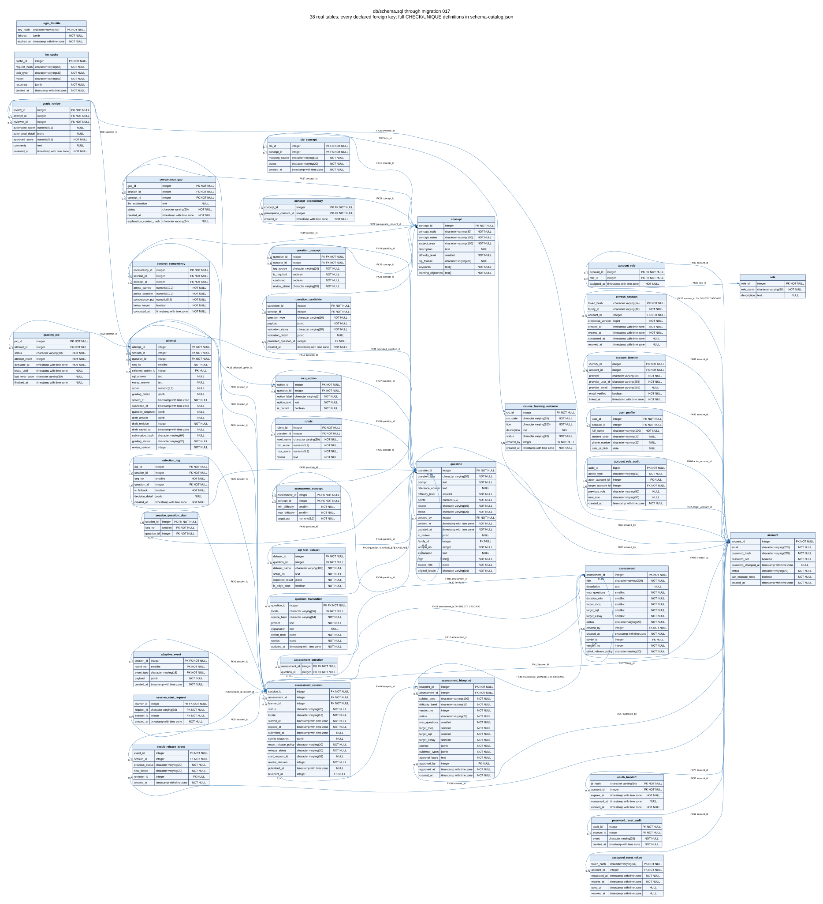

# Cơ sở dữ liệu DBCAS

PostgreSQL 17; DDL chuẩn ở `db/schema.sql`, nâng cấp cộng thêm tại
`db/migrations/`. ORM không tự gọi `create_all` để thay thế migration.

## Thực thể và ánh xạ nghiệp vụ

| Nghiệp vụ | Bảng | Quan hệ/chốt toàn vẹn |
| --- | --- | --- |
| User/Role | account, role, account_role, user_profile | Email duy nhất; FK tài khoản và role; Learner/Administrator |
| CLO/kỹ năng/topic | course_learning_outcome, concept, clo_concept, concept_dependency | Mapping xác nhận; topic = subject_area; độ khó 1–5; graph không có tự phụ thuộc |
| Câu hỏi/lựa chọn | question, question_concept, mcq_option | Mapping nhiều concept, đáp án MCQ thuộc đúng câu |
| Dataset/rubric | sql_test_dataset, rubric | JSON dữ liệu và tiêu chí chấm theo câu, weight/điểm có constraint |
| Exam | assessment, assessment_concept, assessment_blueprint | Target 0–100, giới hạn thời gian/độ khó và blueprint |
| Attempt/answer/result | assessment_session, attempt, session_question_plan | Một attempt cho câu đã serve; nháp/đáp án/điểm/evidence trong attempt; snapshot giữ lịch sử |
| Chấm/duyệt/công bố | grading_job, grade_review, result_release_event | Retry hữu hạn và audit bất biến |
| Năng lực/gap | concept_competency, competency_gap | Unique session/concept; tính lại idempotent |
| AI cache | llm_cache | Key gồm prompt/rubric/model/config, chỉ JSON hợp lệ |
| Refresh | refresh_session | Hash SHA-256 64 ký tự, family 32 ký tự; FK cascade, hạn > ngày tạo |



ERD được sinh từ catalog PostgreSQL bằng `scripts/generate_schema_catalog.py`;
nguồn DOT và ledger FK giữ ID của quan hệ cũ. Bảng refresh mới không lưu bearer
token rõ, có index family để thu hồi, account để quản lý phiên, expiry để dọn.
Index hiện có tối ưu session learner/time, job status/available_at, attempt question,
question/concept đã xác nhận, translation/locale, review queue và unique mapping.
Không đánh index văn bản tùy tiện trước khi có số đo query.

## Khởi tạo và nâng cấp

Từ `backend` với `.env` đã cấu hình `DATABASE_URL` trỏ đúng DB:

```powershell
python -m app.init_db --seed-development
python -m app.init_db
python -m app.migrate
```

Lệnh đầu chỉ dùng khi `DEPLOYMENT_MODE=development`; seed có admin công khai của
repo để chạy local, không dùng ngoài môi trường phát triển. Không có admin mặc
định khi bỏ cờ seed; tạo bằng `python -m app.bootstrap_admin --help`.
DB engine phải tồn tại trước, ví dụ service Compose. Lệnh giữ khóa advisory,
khởi tạo chỉ khi schema rỗng, áp dụng migration có checksum trong transaction,
thêm hai role tham chiếu rồi seed khi được yêu cầu. Chạy lặp không xóa dữ liệu.
Schema lạ có bảng nhưng thiếu account bị từ chối. Không sửa migration đã áp dụng.

Đối với DB có dữ liệu lâu dài: sao lưu/kiểm chứng khả năng restore trước khi áp
dụng. Công việc DN chỉ migrate DB tạm trong test; không tác động các volume dev.
Không dùng `down -v`, reset schema hay xóa volume để nâng cấp.

## Kiểm tra

```powershell
python -m pytest -q tests/test_migrations.py tests/dn/test_database_initialization.py
```

Kiểm tra fresh/pre-OAuth/post-OAuth/current, bảo toàn dữ liệu, lặp an toàn, checksum,
constraint refresh, seed không nhân bản và từ chối seed production/schema lạ.
