# Original v1.1 style specs (2026-11-08)

One spec per original figure type. Pixels are viewed directly in
`docs/qa/diagram-originals/*.png`; “Crop” is the full-res original next to
each spec (same file the redraw must match). Tooling notes: dominant fills
from `Pillow` most-common colours (anti-aliased blends in parentheses);
fonts are sans-serif (looks like Arial / Calibri; use Arial).

## 1. Roadmap (Proposal Fig 1)

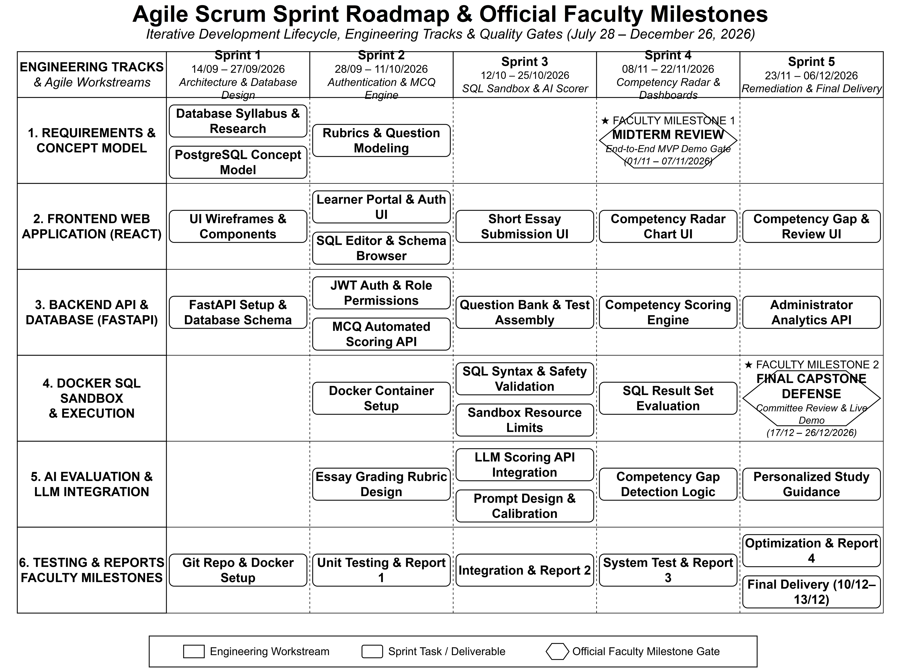

- Notation: table-like Gantt — 6 track rows × 5 sprint columns, rounded-rect
  task chips, diamond milestone gates.
- Shapes: white chips with black stroke, top rule + dashed sprint guides,
  hexagon/diamond for faculty milestones.
- Colours: B&W only (`#FFFFFF`, `#000000`).
- Font: sans bold for titles, regular for chips.
- Arrows: none (containment). Legend box bottom: workstream / task /
  milestone.
- Layout: landscape, 6.10×4.53 in, dense (4712×3497 px, 2.2 MB).
- Elements: 6×5 grid, ≈20 tasks + 2 diamonds.

## 2. System Context (Proposal Fig 2 = Architecture Fig 2, 1431×1061)

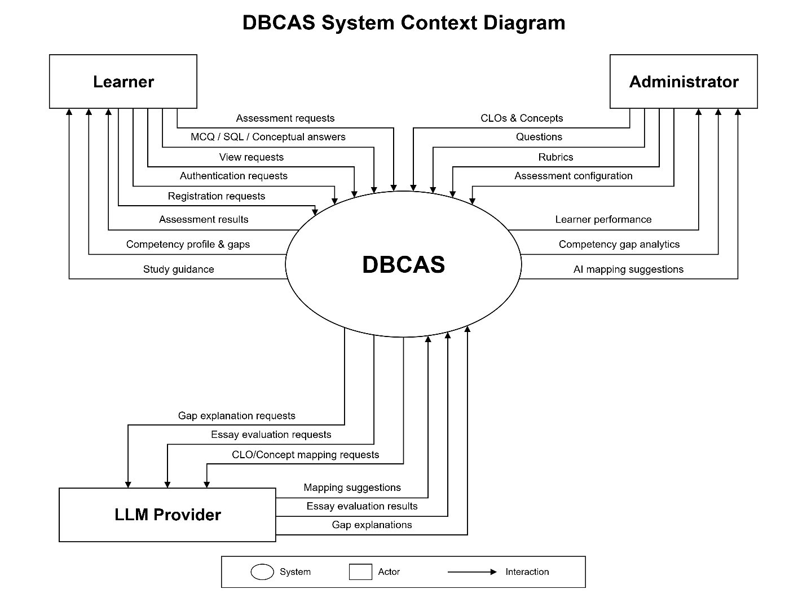

- Notation: box-and-arrow context — rectangles = actors/externals, oval =
  DBCAS system, orthogonal arrows with labels above lines.
- Shapes: 3 rectangles (Learner, Administrator, LLM Provider) + 1 oval.
- Colours: B&W line art, white fill (`#FFFFFF`), black stroke.
- Font: sans bold for names/titles, regular for flow labels.
- Arrows: thin black right-angle elbows, arrowheads, label centred above.
- Title: centred bold “DBCAS System Context Diagram”.
- Legend: bottom boxed — oval = System, rectangle = Actor, arrow = Interaction.
- Layout: actors top-left/top-right, system centre, LLM bottom-left;
  bidirectional fan (8 in / 8 out / 6 LLM flows = 22 arrows approx).
- Margins: small white margin; caption below in doc (not in image).

## 3. Logical (Proposal Fig 3, 3200×3160)

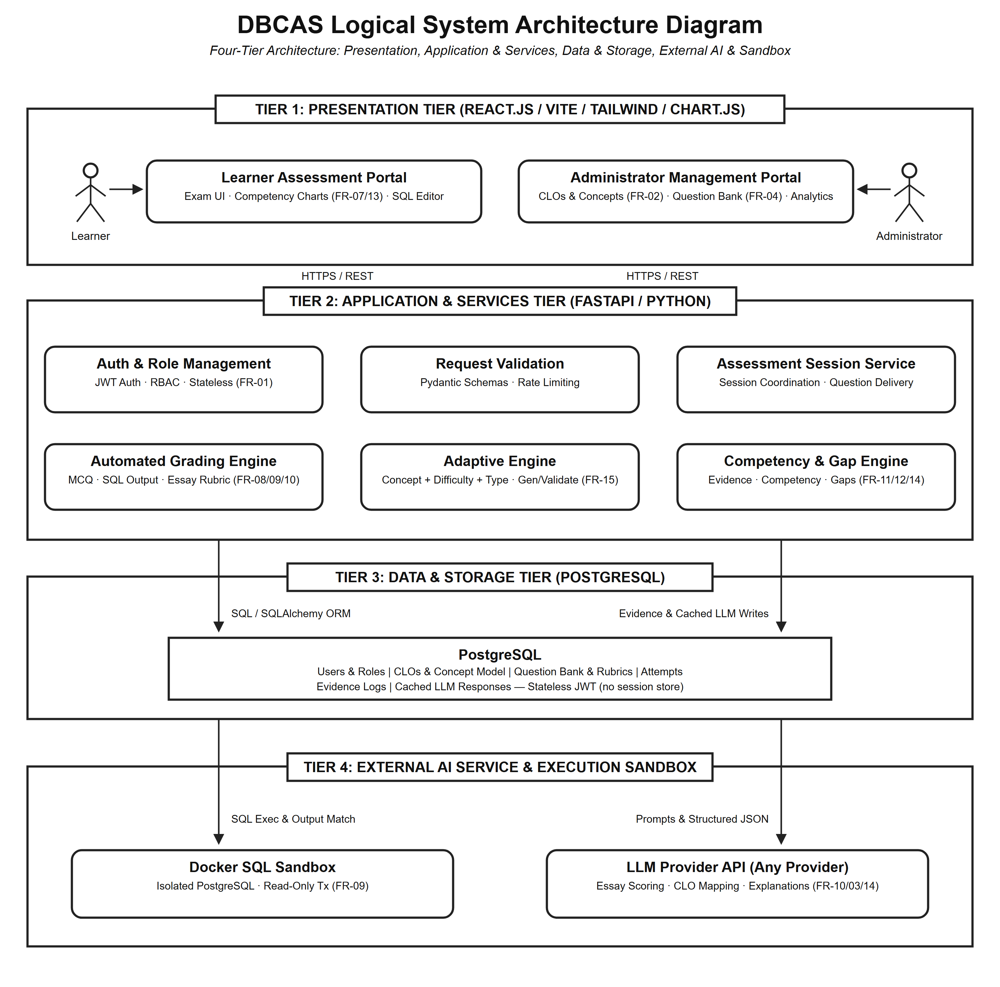

- Notation: layered logical — 4 horizontal tier bands with tab titles.
- Shapes: stick-figure actors; rounded boxes (bold title + small subtitle);
  full-width tier rectangles; vertical arrows between tiers.
- Colours: B&W (`#FFFFFF` fill, black stroke).
- Font: sans bold + regular subtitles.
- Arrows: straight vertical, labels “HTTPS / REST”, “SQL / SQLAlchemy ORM”,
  “Prompts & Structured JSON” etc.
- Title + italic subtitle at top.
- Layout: top-down Tier 1→4, two-column grids per tier.

## 4. Pipeline (Proposal Fig 4, 1342×762)

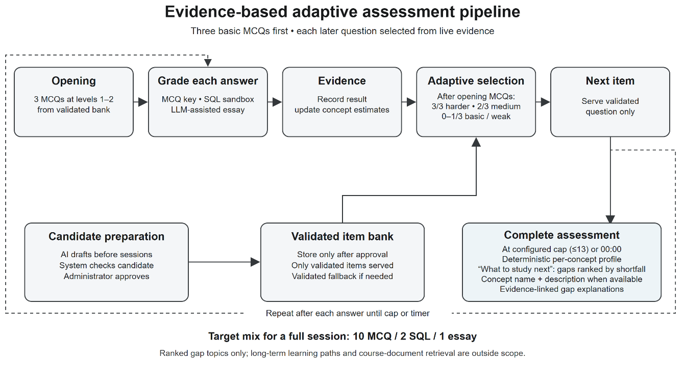

- Notation: flowchart — rounded boxes in a loop, solid forward arrows,
  dashed feedback arcs, italic note footer.
- Shapes: 8 rounded boxes (Opening → Guide → Evidence → Adapt → Next item →
  Complete, plus Candidate prep + Validated bank).
- Colours: light gray-blue fill, dark line.
- Font: sans bold titles, regular body.
- Title + subtitle, “Target mix” bold note, “Ranked gap topics…” italic.
- Layout: two rows (5 top, 3 bottom) with a dashed loop.

## 5. Use Case (Architecture Fig 1, 3000×3300)

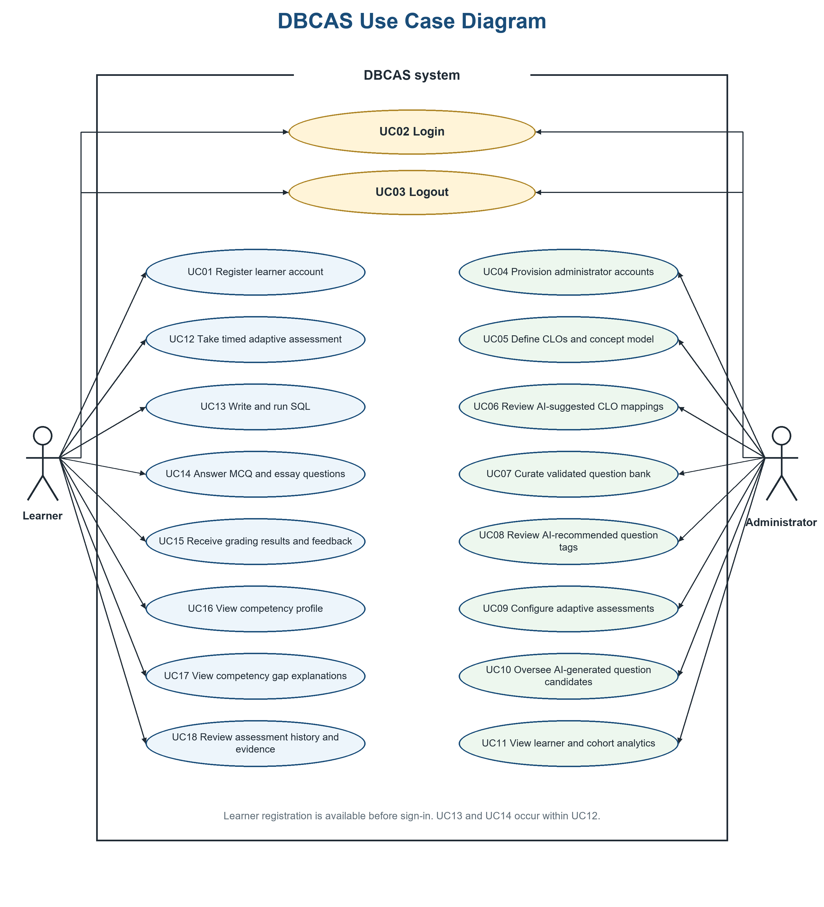

- Notation: UML use-case — stick actors outside, system boundary rectangle
  with top gap for “DBCAS system”, ellipses for use cases.
- Shapes: 2 stick figures; 18 ellipses (UC01–UC18, two columns).
- Colours: top 2 cream (`#FFF7D0` approx), left column light blue
  (`#D6EAF8`), right column light green (`#E8F5E9`), dark navy stroke/text
  (`#0D3B66`). Blue title.
- Font: sans; ellipse text centred.
- Arrows: thin straight lines actor→ellipse (no labels). Note bottom
  centre in gray.
- Layout: portrait (6.10×6.71 in), Learner left / Admin right.
- Margins: note line inside boundary.

## 6. Container (Architecture Fig 3, 1444×1418)

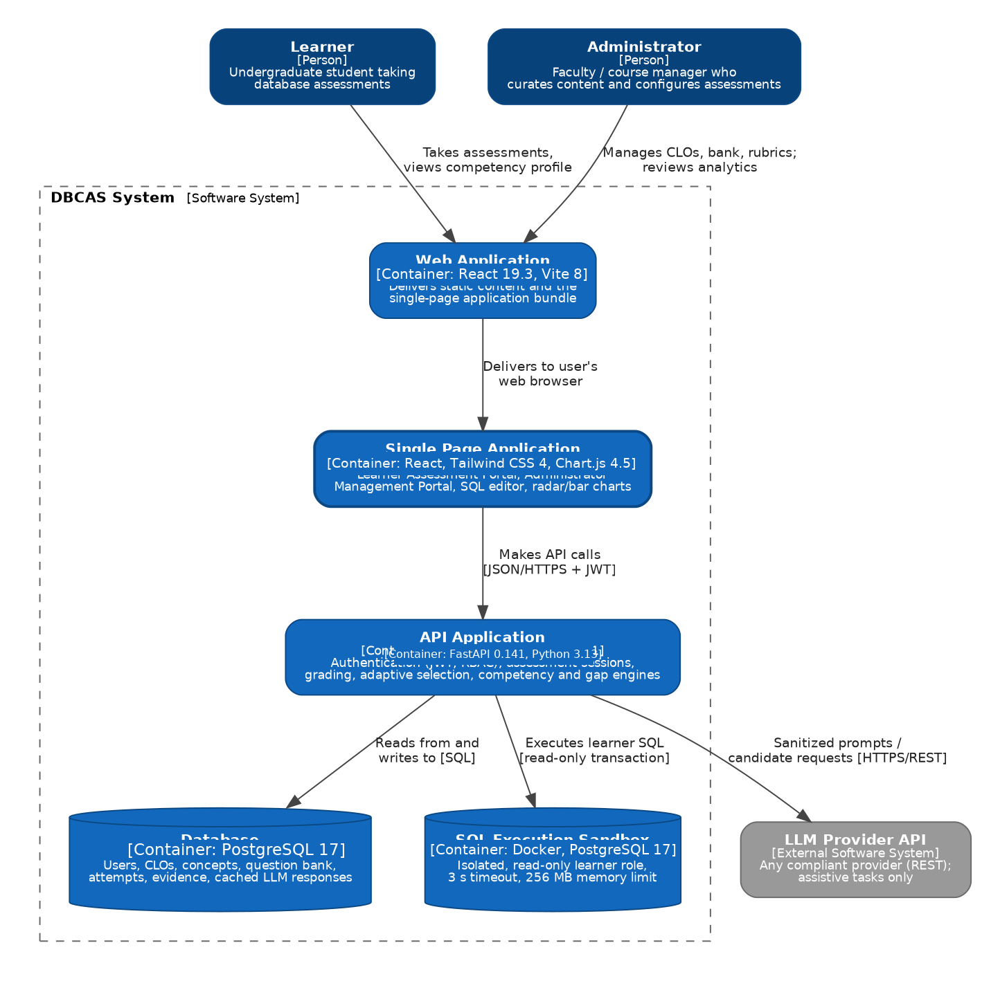

- Notation: C4 container (blue boxes/cylinders) — but keep the same look.
- Shapes: Person boxes (dark blue `#08427B`, white text, rounded),
  Container boxes (mid blue `#1168BD`), cylinders (DB, Sandbox),
  gray external box; dashed system boundary.
- Font: sans white bold titles + small `[Container: …]` + description.
- Arrows: thin dark verticals with centred labels (e.g. “Delivers to browser”).
- Layout: top-down (Person → Web → SPA → API → DB/Sandbox/LLM).
- Quality note: original has overlapping white text inside blue boxes
  (e.g. “Web Application” doubled) — redraw must be clean (no overlap).

## 7. Component (Architecture Fig 4, 2361×1423)

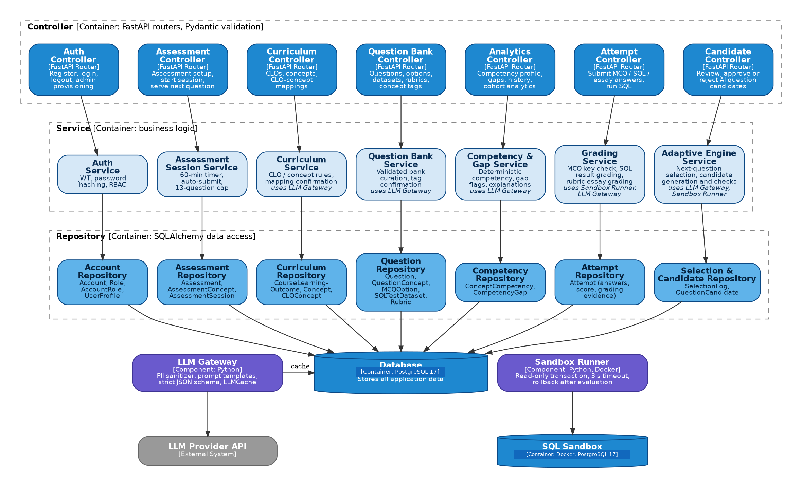

- Notation: component — 3 dashed bands (Controller / Service / Repository),
  vertical top-down arrows.
- Shapes: 7+7+7 rounded boxes (top dark blue with white text, middle light
  blue, bottom mid blue), purple LLM Gateway + Sandbox Runner, blue
  Database cylinder, gray LLM Provider.
- Colours: blues `#0E66BC`–`#4E8DC8`, purple `#7E57C2` approx, gray `#999999`.
- Font: sans bold + `[FastAPI Router]` style tags.
- Layout: landscape grid (7 columns), arrows orthogonal.

## 8. Module (Architecture Fig 5, 3300×2050)

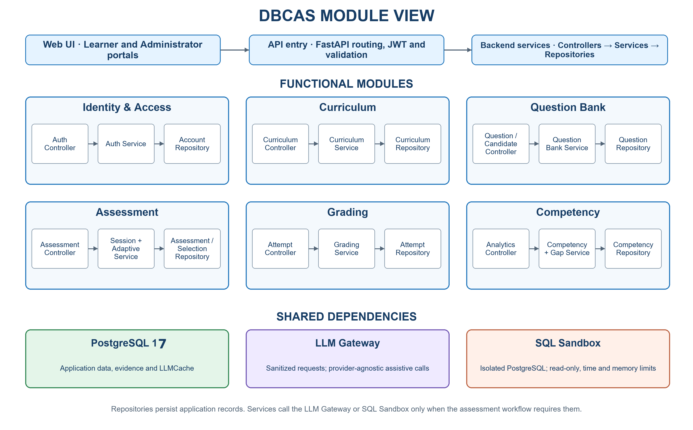

- Notation: module view — top 3 horizontal bars (Web UI → API entry →
  Backend services), middle 2×3 functional modules, bottom 3 shared boxes.
- Shapes: thin blue-border boxes (dark blue text), light-blue parent boxes
  with 3 white inner chips + `→` arrows.
- Colours: outer `#0D3B66`, fills pale blue/green/purple/orange for shared.
- Font: sans bold titles.
- Footnote centred at bottom (gray).

## 9. Allocation (Architecture Fig 6, 1331×1283)

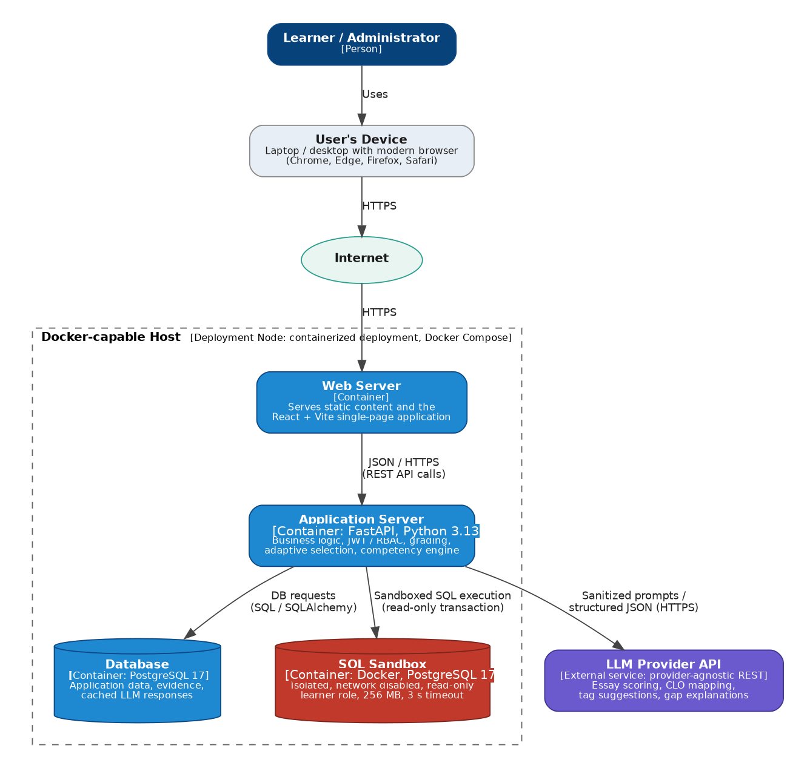

- Notation: deployment — vertical stack: Person → Device → Internet ellipse
  → dashed Docker host → Web/App/DB/Sandbox/LLM.
- Shapes: dark-blue Person, gray Device, teal Internet ellipse, blue
  containers, blue/red cylinders, purple LLM.
- Colours: same blues as Container; red sandbox `#C0392B`.
- Arrows: vertical with “Uses / HTTPS / JSON-HTTPS” labels.
- Quality note: overlapping white text in blue boxes — redraw clean.

## 10. ERD — Chen (Architecture Fig 7 = Database Fig 1, 3251×1677)

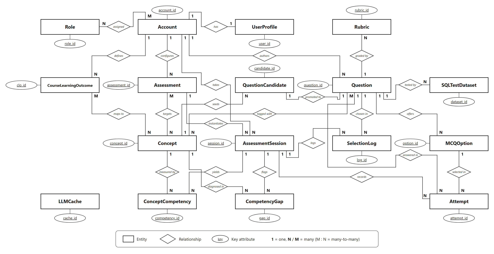

- Notation: Chen ERD — white rectangles = entities, small ellipses = key
  attributes (`account_id` underlined), diamonds = relationships (italic),
  lines with `1`/`N`/`M` cardinalities.
- Shapes: 17 rectangles (Role, Account, UserProfile, Rubric, CLO,
  Assessment, QuestionCandidate, Question, SQLTestDataset, Concept,
  AssessmentSession, SelectionLog, MCQOption, LLMCache, ConceptCompetency,
  CompetencyGap, Attempt) + 17 key ellipses + ~20 diamonds.
- Colours: B&W (`#FFFFFF` fill, black stroke).
- Font: sans bold entity names; relationship labels italic.
- Title: none in image (caption in doc). Legend bottom boxed:
  Entity / Relationship / Key attribute / `1`=one, `N/M`=many.
- Layout: landscape 8.89×4.58 in (Arch) / 9.46×4.88 in (DB), multi-row.
- Cardinalities at both line ends.

## 11. TRD — crow's foot (Architecture Fig 8 = Database Fig 2, 3440×2080)

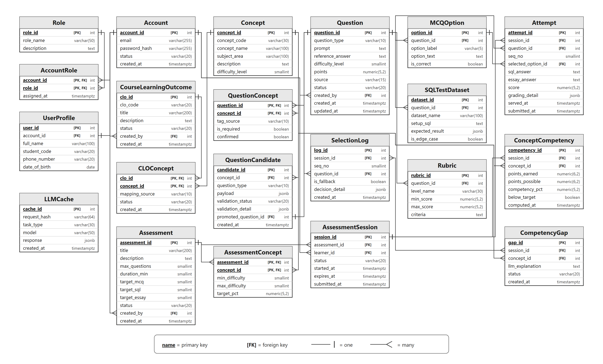

- Notation: physical — table cards (header bar + column rows) + crow's foot
  lines (`—|` one, `—<` many).
- Shapes: 21 cards (Role … Attempt, subset shown) with PK bold/underlined,
  `[PK]`/`[FK]` tags & types (`int`, `varchar(255)`, `timestamptz`…).
- Colours: header light gray `#E8E8E8`, white rows, black lines.
- Font: sans; PK bold-underlined; types right-aligned small.
- Legend bottom boxed: `name` = PK, `[FK]` = FK, `—|` one, `—<` many.
- Layout: landscape, grid ~5 columns × ~4 rows + spares (LLMCache alone).
- Levels: column subset (~5/card), not full 36-table schema.

## v1.2 in-place redraws — what they kept / got wrong

`docs/qa/doc-v2-new-diagrams/*.png` (Proposal Fig 2; Arch Figs 1, 3–8):

- **Kept:** same notation/shapes/palette/font family and original figure
  extents/ratios; captions unchanged; 41-table TRD (more complete than the
  21-card original, marked for follow-up); EU “keep” was correct for context/
  ERD/TRD but:
- **Got wrong / dropped:** many redraws reduced detail to fix fake facts —
  e.g. Proposal Fig 2 v1.2 adds OAuth/Email boxes and shortens flows (good
  content, but arrows are diagonal long curves vs original orthogonal elbows);
  Use Case v1.2 renames UC09/UC12 to “result flow/settings” and “personalized
  practice” (real project) — correct content, but ellipse fills/labels were
  swapped and the bottom note dropped; ERD v1.2 shrinks to 12 core + 4 dashed
  legacy entities (good correction) but drops diamonds→? and loses the dense
  17-entity layout, adding a separate legacy row that the original never had;
  TRD v1.2 shows 41 cards with PK/FK but simplified column lists (“first 5 +
  …more”) — closer to original card grammar, still too sparse. In short:
  v1.2 proves the *template* is right; the v3 redraw must be full-detail
  (correct rows/labels/arrows), not a subset.
