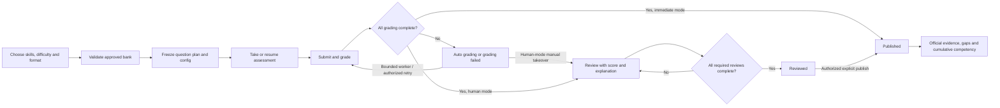

# Supervisor requirements — 15 October 2026

Audit target: `develop2`, original HEAD `a86eddc76cfd63c2bbdf34b228b05de627bb0c24`.
The original implementation report described a clean tree before that work.
The independent acceptance audit actually began with **45 modified tracked and
13 untracked files**, preserved before stabilization; see the
[current acceptance evidence](#independent-final-acceptance-audit).
`DBCAS-frontend-src` is a separate sibling; this implementation extends the
maintained `DBCAS` repository only.

**Original implementation verdict: COMPLETE for mandatory requirements R1–R8.** The existing
application is extended end to end, with learner/admin integration, safe local
database upgrade, deterministic cumulative scoring and automated verification.
Future F1/F2 and external production release checks remain explicitly separate.
The independent final acceptance audit below supersedes that original verdict
for release purposes and records subsequently reproduced defects and clean reruns.

## Initial requirements matrix

| ID | Requirement | Existing implementation | Status | Evidence | Required changes |
|---|---|---|---|---|---|
| R1 | Skill-based selection | Administrator configures concepts; learner selects an assessment only | PARTIAL | `backend/app/services/assessment_service.py:250`, `frontend/src/pages/AssessmentsPage.jsx:17` | Learner concept selection, validation and immutable selection snapshot |
| R2 | Difficulty selection | Questions and concept ranges use levels 1–5; admin editing/filtering works | PARTIAL | `backend/app/models.py:130`, `backend/app/schemas.py:520`, `frontend/src/pages/admin/AdminQuestionsPage.jsx:339` | Reuse levels with explicit EASY/MEDIUM/HARD bands; strict learner filtering |
| R3 | Personalized assessment assembly | Adaptive engine serves validated questions at runtime with snapshots, quotas, audit log, resume and start lock | PARTIAL | `backend/app/services/adaptive_engine.py:375`, `backend/app/services/evidence_context.py:10`, `backend/app/repositories.py:378` | Freeze full personalized question plan at creation; random combinations, exact filtering, skill coverage and idempotency |
| R4 | Question tagging | Confirmed concept junction, difficulty, validation checklist, imported bank and admin filters | COMPLETE | `backend/app/models.py:249`, `backend/app/services/question_service.py:329`, `frontend/src/pages/admin/AdminQuestionsPage.jsx:174` | Retain and reuse; document existing classification review |
| R5 | Result release configuration | Finalization and queued grading exist; no human publication policy | MISSING | `backend/app/services/assessment_lifecycle.py:201`, `backend/app/services/session_guard.py:49` | Policy, independent release lifecycle, backend visibility guards, safe historical handling |
| R6 | Human grading verification | Admin reviews question curation, not submitted grades | MISSING | `backend/app/routers/admin.py:372`, `backend/app/services/grading_jobs.py:15` | Authorized submission review, bounded corrections, immutable audit, concurrency and publish controls |
| R7 | Cumulative competency evaluation | Deterministic point-weighted per-session competency; dashboard selects a single session | PARTIAL | `backend/app/services/competency_service.py:61`, `frontend/src/pages/DashboardPage.jsx:150` | Published multi-session evidence aggregation and cumulative learner/admin view |
| R8 | Concept metadata for AI | Description, subject area, SQL technique, CLO learning outcomes and prerequisite graph already exist | PARTIAL | `backend/app/models.py:227`, `backend/app/services/curriculum_service.py:50`, `frontend/src/pages/admin/AdminCurriculumPage.jsx:160` | Bounded keywords/objectives metadata, management and snapshots; preserve existing references |

## Baseline

- Frontend: `npm test`: 25 files, 189 tests passed.
- Frontend: `npm run build`: passed; existing warning about a bundle above 500 kB.
- Backend: `.venv/Scripts/python.exe -m pytest -q`: 850 passed, one existing
  Starlette/httpx deprecation warning, 656.51 seconds. This was the unmodified
  application baseline.
- Stack confirmed: FastAPI, SQLAlchemy 2, psycopg 3, versioned SQL migrations,
  PostgreSQL 17, React 19, Vite 8, Tailwind 4, Vitest and Playwright. No separate
  lint or TypeScript scripts are configured.

## Existing architecture retained

- Backend routers remain under `/api/v1`; `deps.py` loads the active account
  and its current database roles for every authenticated request. Existing
  Learner/Administrator authorization, password authentication and OAuth identity
  flows are retained. No teacher role or alternative authentication system was added.
- SQLAlchemy models/repositories represent questions, confirmed concept tags,
  CLO mappings and prerequisites, assessment rules, sessions, submitted answers,
  selection logs, competencies, gaps and grading jobs. The existing checksum
  migration runner uses a transaction and an advisory lock.
- The original adaptive engine selects from the validated reusable bank and
  supports start/resume, fixed configured limits, per-question snapshots,
  revision-controlled drafts, timeouts and idempotent submissions. MCQ grading,
  SQL comparison/technique checks, rubric-based essay grading and point-weighted
  competency calculations remain in their existing services.
- SQL execution uses the separate sandbox PostgreSQL service and `learner_ro`
  role, per-execution fixture schemas, read-only transactions, rollback,
  statement/connect deadlines and bounded results. The application database is
  never an execution target. Existing validation and isolation were not relaxed.
- The existing OpenRouter-compatible LLM layer validates structured output,
  redacts identifiers and caches valid responses. Missing provider configuration
  remains supported. Existing candidate generation is an administrator curation
  tool; it is not part of personalized starts or cumulative scoring.
- The in-process maintenance thread sweeps expiry and bounded SQL grading jobs.
  The separate essay worker still requires `--allow-provider-calls`. New review
  retry APIs enqueue work without making provider calls themselves.
- The React application keeps its existing learner Dashboard, Assessments,
  Exam, History/Evidence and Settings pages, plus administrator curriculum,
  question bank, candidates, assessments, accounts and analytics. The new
  selection/review/cumulative views use the same layout, tokens, route guards,
  loading/error components and English/Vietnamese localization. Existing Chart.js
  visualizations, responsive layouts and accessibility checks are retained.

## Implementation decisions

- Reuse published assessment configurations as shared rules, never create a
  fixed examination per learner. The learner selects a subset (or all) of a
  configuration's concepts. Existing starts without selections retain their
  original adaptive behavior and scoring.
- Existing numeric difficulty is authoritative: EASY = 1–2, MEDIUM = 3,
  HARD = 4–5. Intersect these bands with administrator-configured ranges.
  Personalized sessions freeze the complete question plan at start and do not
  apply the legacy easy opening/adaptive substitution to a harder selection.
- Formal assessments use their shared rules' exact duration and question mix.
  Current new/versioned rules preserve the 60-minute, 10 MCQ / 2 SQL / 1 essay
  contract; older published configurations retain their original limits.
  Explicit `PRACTICE` requests specify 1, 2, 3, 5, 10 or 13
  questions and balance the formats actually available for the selected topic.
  This is necessary because a read-only audit found **no single-concept pool**
  satisfying the complete formal mix at one difficulty band. Practice can assess
  a conceptual topic with MCQ/essay without requiring unrelated executable SQL.
  Neither format relaxes skill, difficulty, validation or requested length.
  Practice prefers balanced formats, then tries the nearest feasible mix if
  coverage or shared version families require a different distribution. Formal
  type quotas remain exact. A deterministic exhaustive small-bank oracle checks
  that practice accepts feasible selections and rejects genuinely insufficient pools.
- Result release is independent of the completed/timed_out session lifecycle.
  Existing historical records keep immediate access under the migration policy;
  new sessions enter an explicit grading and publication lifecycle.
- Human verification requires review of every submitted SQL/essay item. Pending
  or failed automatic grading can be taken over with an explicit score and comment;
  unavailable providers never fabricate a score. All required reviews and all
  submitted grades must be complete before explicit publication.
- Cumulative competency pools earned/possible points across published sessions,
  preserving full contribution to each confirmed concept. Repeat assessments
  remain separate evidence. Target thresholds are weighted by the amount of
  benchmarked evidence using the original immutable session targets. No AI calls
  are required for this report.

## Verification, delivery and operational instructions

Final verification is recorded below as gates complete. No paid provider calls,
commits, pushes, merges or deployments are performed. Schema upgrades use the
existing additive migration runner; never reset or delete a database volume.

## Implemented behavior and primary files

| ID | Final status | Implementation | Files and verification |
|---|---|---|---|
| R1 | COMPLETE | One/multiple/all published target concepts, strict server validation, exact selected IDs and historical concept metadata | `services/personalized_assessment.py`, `routers/assessments.py`, `components/PersonalizedAssessment.jsx`; selection, invalid ID, coverage, resume and persistence tests |
| R2 | COMPLETE | EASY 1–2, MEDIUM 3, HARD 4–5 intersect existing concept ranges; original admin numeric classifications remain authoritative | Same assembly service and learner form; five band tests and existing question CRUD/filter/localization tests |
| R3 | COMPLETE | Random approved-bank combinations, coverage search, exact type quotas, version-family deduplication, complete frozen question plan, UUID idempotency plus transactional start locks | `services/personalized_assessment.py`, existing `adaptive_engine.py`, `evidence_context.py`, session repository; repeated/concurrent creation, immutable resume, insufficient pool, formal/practice and grading integration tests |
| R4 | COMPLETE | Existing admin classification, confirmed tags, 1–5 validation, filters, imported bank validation, versioning and eligibility checklist retained | Existing `question_service.py`, `AdminQuestionsPage.jsx`, bank import and regression suites; no historical question classifications invented |
| R5 | COMPLETE | Assessment-level release policy, immutable session policy, separate release status, guards and learner pending states | `services/grading_review.py`, `session_guard.py`, `session_service.py`, grading lifecycle/jobs, assessment forms and learner evidence/history/dashboard |
| R6 | COMPLETE | Administrator review queue and historical drill-down, original automated evaluation, bounded approved score, reviewer/time/comment audit, revision conflicts and explicit human publication | `routers/admin.py`, `services/grading_review.py`, `AdminGradingPage.jsx`; real SQL/essay workflows, stale/concurrent reviews, self-review, RBAC, takeover and late-worker fencing tests |
| R7 | COMPLETE | Point-pooled published evidence, historical weighted benchmarks, recurring strength/gap counts, learner and authorized admin cumulative view | `services/cumulative_competency.py`, `CumulativePage.jsx`, learner navigation/dashboard and admin analytics links; deterministic weighted/empty/multi-attempt/exclusion tests |
| R8 | COMPLETE | Bounded keywords and learning objectives extend existing descriptions, subject areas, SQL features and CLO references | `ConceptMetadata`, curriculum service/form, immutable snapshots and existing admin AI context builders; validation, roundtrip and partial-update tests |

Paths in the table are under `backend/app` or `frontend/src` unless stated otherwise.
The new acceptance suite is `backend/tests/test_supervisor_requirements.py`;
UI tests are `frontend/src/test/SupervisorWorkflows.test.jsx` and the added
human-result regression in `ExamPage.test.jsx`.

## API contract

All paths retain the existing `/api/v1` prefix and authentication/error envelope.

| API | Behavior |
|---|---|
| `GET /assessments` | Adds safe target concept metadata and result release policy; never exposes answer keys or a question plan |
| `POST /assessments/{id}/sessions` without a body | Existing adaptive start/resume behavior |
| Same POST with `concept_ids`, `difficulty`, `request_id` | Formal personalized assembly using the shared published rules |
| Same POST with `mode: "PRACTICE"`, `question_count` | Explicit shorter topic assessment; same bank, ownership, snapshots and grading pipeline |
| `GET /sessions`, `GET /sessions/{id}` | Include safe policy/status, assembly mode and selection metadata; unpublished official scores/concepts are withheld |
| `GET /sessions/{id}/evidence`, `/competency`, `/gaps`, `/guidance` | Ownership first, then publication guard; unpublished results return 409 `results_pending` with safe status details |
| `POST /sessions/{id}/answers` and `/submit` | Human-verification responses have null score and correctness before publication, including idempotent retries |
| `GET /sessions/competency/cumulative` | Current learner only; deterministic published multi-assessment profile and ranked gaps, no LLM dependency |
| `GET /admin/grading-reviews?offset=0&limit=100` | Submitted human-review queue plus terminal grading failures; Administrator only, bounded pagination |
| `GET /admin/grading-reviews/{session_id}` | Authorized provisional/final evidence, rubrics, reference answers, original automation, reviews and publication events |
| `POST /admin/grading-reviews/{session_id}/attempts/{attempt_id}` | `{revision, score?, comments?}`; omitted score accepts a valid automated suggestion; incomplete/failed automation needs an explicit score and explanation |
| `POST /admin/grading-reviews/{session_id}/publish` | `{revision}`; all submitted items graded and all required human reviews complete; stale state conflicts |
| `POST /admin/grading-reviews/{session_id}/retry` | `{revision}`; requeues terminal failures under locks without calling a provider in the request |
| `GET /admin/learners/{account_id}/competency/cumulative` | Administrator-only cumulative report for an existing learner |
| Existing concept create/update/list | Adds bounded `keywords` and `learning_objectives`; omitted PATCH fields preserve existing metadata |

`request_id` is a client-generated UUID. Repeating it with identical selections
returns the same session even after completion. Changing its assessment, skills,
difficulty, format or length returns 409. A live session with different selections
must be resumed or finished first. Unknown fields, invalid difficulty/count values,
duplicate/unauthorized skills and insufficient approved pools are rejected.
Skill lists accept up to 100 unique offered concepts independently of question
count. A multi-tag question can cover several skills; the assembler must still
prove complete coverage within the configured question count or reject the pool.

## Lifecycle and confidentiality



The existing `in_progress/completed/timed_out` session status remains unchanged.
The separate release state is `unsubmitted`, `auto_grading`, `grading_failed`,
`pending_review`, `reviewed` or `published`. Fresh rows default to `unsubmitted`.
Immediate publication occurs only after finalization and complete automatic
grading. Human mode requires review of every submitted SQL and essay response;
MCQ review is optional, and explicit publication is still required.

Unpublished results are rejected by the common learner result guard. Learner
history omits official percentages and concept results; the dashboard selects
published sessions; cumulative reports select published evidence. There are no
result export endpoints in the current application. Exam responses redact human
scores/correctness before publication, and the UI renders an answer-saved message
instead of interpreting null correctness as an incorrect answer. API responses
retain the existing `Cache-Control: no-store` header.

History, Dashboard and Evidence refresh every five seconds while automatic
grading remains outstanding, bounded to five minutes and cancelled on unmount
or resolution. Human review waits do not poll; manual refresh remains available.
This lets asynchronous SQL grades appear after completion without exposing a
provisional result or requiring navigation away and back.

Graders use the existing Administrator role. Ownership checks prevent another
learner reading a session, and self-review/self-publication are rejected even
for an account with both roles. Review and publication use session row locks,
attempt/session revision checks and an immutable audit record. A manual takeover
also completes/invalidate-locks the grading job so a late worker cannot overwrite
the approved result. Worker completion checks both the claim counter and lease
deadline, preventing an old worker from matching a new claim after an authorized
retry resets its budget. Human review never runs learner SQL against the system DB:
SQL evaluations still use the original read-only, timed, bounded sandbox.

The review UI shows original automated scores and feedback, submitted answers,
rubrics, reference criteria, SQL evaluation details, approved scores and comments.
Published reviews remain available through the administrator analytics link at
`/admin/grading/{session_id}`. Failed grades can be requeued; essay retries still
require the operator's existing explicit provider-worker authorization. Human-mode
manual takeover works while the provider is unavailable, without paid calls.

## Database changes and historical handling

Migration: `db/migrations/008_personalization_and_verified_results.sql`.
Fresh installs include exactly the same SQL at the end of `db/schema.sql`.
Migrations 001–007 are unchanged.

- `concept`: additive `keywords TEXT[]` and `learning_objectives TEXT[]`, empty by
  default. No invented classifications or content backfills.
- `assessment`: `result_release_policy`, default `IMMEDIATE`, constrained to the
  two supported policies.
- `assessment_session`: immutable copied policy and start UUID, separate release
  status, optimistic review revision and publication timestamp. The existing
  immutable JSON snapshot also carries selected concepts, band, format, requested
  length, exact question IDs and complete server-only question snapshots.
- `attempt`: optimistic `review_revision`; existing score becomes the approved
  authoritative value after review. Original automation is retained separately.
- `concept_competency`: earned/possible capacity widens from NUMERIC(6,2) to
  NUMERIC(10,2), preserving scale, values and formula. The previous capacity could
  overflow for thirteen otherwise valid 999.99-point questions (12999.87 total).
- `grade_review`: unique attempt FK, original automated score/detail, approved
  score, reviewer account FK, comments and timestamp. Update/delete triggers
  preserve the audit record.
- `result_release_event`: append-only session status history with actor and time.
- `session_question_plan`: immutable ordered question FKs and per-session unique
  question constraint. Every reserved question is protected before serving;
  administrative edits clone its version and preserve original MCQ option IDs.
- Indexes: partial unique `(learner_id,start_request_id)`, release queue index,
  reviewer/time index, session/event index and reserved-question lookup index.
  Existing indexes and data remain.
- Policy/start UUID and existing question/config/locale snapshots cannot be
  changed after creation. No destructive migration, reset, truncation of user
  tables, or question reclassification is part of the application upgrade.

Historical fully graded finalized sessions retain immediate published access.
Previously incomplete grading is explicitly marked `auto_grading` or
`grading_failed`; in-progress sessions remain unsubmitted. No historical review
identity or publication time is invented, and original snapshots, answers,
scores, question IDs and assessment rules remain intact. The migration runner's
checksum ledger and advisory lock make rerunning an applied upgrade a no-op.
Migration tests exercise fresh, pre-OAuth, post-OAuth and current schemas plus
preservation of completed/incomplete historical evidence and safe new defaults.

## Cumulative calculation

For each concept, pool only submitted, graded evidence from published sessions:

`competency_pct = SUM(approved points earned) / SUM(possible points) * 100`

Use Decimal arithmetic and the existing two-decimal HALF_UP rounding. Full score
contribution to every confirmed concept is unchanged. Served/unanswered items,
missing scores and unpublished sessions are not evidence. Repeated assessments
contribute separate observed points; earlier attempts are never overwritten.

When historical assessments have different benchmarks, the cumulative target is
`SUM(possible points * historical target) / SUM(benchmarked possible points)`.
Evidence lacking a benchmark contributes to competency but not to this target
denominator; an entirely unbenchmarked concept never becomes a detected gap.
Rank gaps by target shortfall descending, then concept ID. Recurring strengths
and weaknesses count published assessments meeting/falling below their own
immutable benchmark. Evidence IDs and session counts remain traceable.

Example: 1/1 followed by 0/9 gives **10%**, not the 50% arithmetic mean of two
assessment percentages. Targets 60 and 80 for those same evidence sizes give a
78% evidence-weighted target. Deterministic tests cover this case. Category means
retain their original descriptive display meaning and are not authoritative
competency scores. Reports work with zero history and no LLM service.

## Manual verification

Start from the repository root in PowerShell, keeping the existing `.env`:

```powershell
docker compose up -d db sandbox
cd backend
.venv/Scripts/python.exe -m app.migrate
# Disable provider use inside this single Python process, without editing .env:
.venv/Scripts/python.exe -c "import os; os.environ.update(LLM_API_KEY='', LLM_BASE_URL='', LLM_MODEL=''); import uvicorn; uvicorn.run('app.main:app', host='127.0.0.1', port=8000)"
```

In another PowerShell terminal from the repository root:

```powershell
cd frontend
npm run dev
```

Open `http://localhost:5173`. Use existing accounts; do not reset a database or
publish test questions into an existing user bank.

The offline launcher deliberately uses one process without reload. Windows
PowerShell can remove an environment variable when assigning an empty string,
which would allow `.env` to supply the provider key again. Setting the empty
values in Python keeps provider use disabled for this verification process.

1. **Skill selection:** sign in as Learner, open Assessments, select shared
   rules, choose Topic practice, a question count, and one or multiple skills.
   “Select all skills” requests comprehensive coverage. The original assessment
   list and Start/Resume actions continue to use the original adaptive flow.
2. **Difficulty:** choose Easy, Medium or Hard. Submit; an unsupported pool shows
   a localized error and creates no session. Choose a shorter explicit practice
   length or another supported selection; the system never relaxes the band.
3. **Automatic creation:** start, answer, save a draft and refresh. The same
   question/answer and countdown resume. Submit and continue through the exact
   requested length. Formal format still requests the configured formal mix.
4. **Immediate results:** use rules with Immediate policy. A one-question MCQ
   practice can verify this without an LLM. Finish, then inspect History,
   assessment evidence and Dashboard. Pending/failed grading withholds official
   results until completed; administrator retry is available for terminal failures.
5. **Human-reviewed results:** as Administrator, create a draft or close an
   existing template and use New version, set Human verified, preserve concept
   targets, then publish the rules. As Learner, finish an assessment under those
   rules; History/Evidence show a pending state and cumulative competency excludes it.
6. **Grading approval:** as Administrator, open Grading review, select the learner's
   submission, inspect each SQL/essay answer and its provisional evidence, accept
   or correct scores, and add comments. If automation is pending/failed, supply
   an explicit score and explanation. Complete all required reviews and click
   Publish verified results. Refresh the learner's evidence to see official grades.
7. **Cumulative evaluation:** complete/publish a second assessment, open Cumulative
   competency from learner navigation or Dashboard, and check pooled points,
   contributing assessment counts, recurring strengths/gaps and ranked learning
   areas. Individual History results remain separate. Administrator analytics
   provides a cumulative link for the selected learner and a historical review link.

For clean automated fixtures without paid provider calls:

```powershell
cd backend
.venv/Scripts/python.exe -m pytest -q
.venv/Scripts/python.exe -m compileall -q app
.venv/Scripts/python.exe -m pip check
cd ../frontend
npm test
npm run build
npx playwright install chromium
$env:DBCAS_E2E_OUTPUT='../../_review/supervisor-20261018/final-browser'
$env:DBCAS_TEST_MANIFEST='<local path to the generated test-container manifest>'
npm run test:e2e
```

The optional manifest variable isolates ownership-checked test cleanup from any
older review run. Browser tests use disposable PostgreSQL/sandbox containers,
real HTTP APIs and the real LLM validation/cache service with MockTransport.
They do not use or modify the existing user database. Full backend and browser
gates should run sequentially on constrained Docker hosts.

## Future work and limits

- **F1 — adaptive batches:** the existing three-question opening/adaptive engine
  remains intact for original starts. New personalized assessments freeze their
  selected difficulty and complete question plan. Future five-question adaptive
  batches can reuse the selector, selection audit, draft and snapshot mechanisms;
  progressive difficulty/stop criteria were not added in this implementation.
- **F2 — real-time generated questions:** existing administrator candidate
  generation remains manually invoked, sandbox/rubric validated and human curated.
  New metadata is bounded, serialized as data, redacted through the existing LLM
  service and accompanied by an instruction/data boundary. Personalized starts
  make no question-generation call. Real-time generation needs an approved
  candidate lifecycle and independent validation before learner presentation.
- Sparse banks can still make a particular skill/difficulty/length unavailable.
  The UI offers explicit short practice and actionable insufficiency errors.
  No unverified historical classifications or additional questions were invented.
- Approved review records are immutable; post-publication regrading/appeals are
  a future explicit audit workflow. No new teacher/global role was introduced.
- Live paid-provider and OAuth consent checks are outside this task's executed
  verification. Automated provider transports are mocked; SQL execution is real.
- The host virtual environment is Python 3.14.5; the documented release target
  is Python 3.13. Release-image verification is reported separately below.
- Existing Vite bundle-size and Starlette/httpx deprecation notices are retained.
  No lint/TypeScript scripts were configured; those checks must not be reported
  as passed merely because tests or a JavaScript build succeeded.

## Execution record

- Baseline: backend **850 passed**, frontend **189 passed**, production frontend
  build passed, existing bundle-size warning.
- Initial integration subset: **76 passed** (migration, original adaptive/draft,
  curriculum, assessment and result contracts).
- Intermediate full backend run: **877 passed**.
- A subsequent run: **885 passed, 1 failed**. The legacy grading-to-competency
  test manually changed `session.status` without completing the new publication
  lifecycle. It now finishes through the actual HTTP API; the learner guard was
  retained. The corrected regression and all new edge cases subsequently passed.
- Latest focused backend gate: **55 passed**, including all new supervisor,
  migration and corrected grading-to-competency checks.
- Subsequent bank-edit/deletion regression gate: **66 passed**. The complete
  backend suite then passed **901 tests**, one existing warning, in **745.41s**.
  A final curation-race guard adds two further checks. Its first targeted run
  had one fixture failure because the simulated successor reused version 1;
  the fixture now creates version 2, respecting the original unique constraint.
  The corrected targeted run passed **2 tests**. Final full-suite results are
  recorded below after execution.
- Latest complete regression run:
  `.venv/Scripts/python.exe -m pytest -q --junitxml=../../_review/supervisor-20261018/backend-verified.xml`
  — **903 passed**, **0 failed**, **0 skipped**, one existing deprecation warning,
  **745.67s**. This run preceded the last practice-format feasibility refinement.
- After that isolated selector refinement, the complete supervisor acceptance
  suite ran again against the final code:
  `.venv/Scripts/python.exe -m pytest -q tests/test_supervisor_requirements.py --junitxml=../../_review/supervisor-20261018/supervisor-final.xml`
  — **55 passed**, **0 failed**, one existing warning, **63.11s**. This includes
  real-database integration, grading/publication security and deterministic
  selection tests, including 100 small banks checked against an independent
  exhaustive feasibility oracle. The full regression and final focused counts
  are separate executions; they are not added together as distinct tests.
- Latest frontend gate: **205 passed in 27 files**, **42.39s**, build passed
  in **1.36s**. `npm audit --audit-level=moderate`: **0 vulnerabilities**.
  `pip check`: no broken requirements. Python compileall passed.
- Both development and release Compose syntax checks passed; fresh schema and
  migration 008 SQL parity check passed; Python compileall and application import
  passed. Complete frontend tests include EN/VI key/interpolation checks.
- First browser launch was blocked by a missing matching Chromium binary; this
  was an environment failure before either journey ran. Installed the required
  Chromium. An intermediate full browser run had **20 passed / 8 failed**:
  seven dashboard checks exposed the need to refresh after asynchronous grading,
  and one caught temporary horizontal canvas overflow. Bounded status refresh
  and chart containment fixed these without relaxing publication guards.
- Complete Chromium suite: **28 passed**, **0 skipped**, **0 flaky**, **0 failed**,
  **905.69s**. Includes all original journeys, new supervisor journeys A–E,
  single-topic practice using the existing approved bank, English/Vietnamese,
  390/768/1024/1440 widths, themes, accessibility, drafts, SQL, essays, expiry
  and ownership. Report:
  `../../_review/supervisor-20261018/final-browser-rerun/browser-results-chromium.json`.
- Built the actual backend Dockerfile successfully as local image
  `dbcas-supervisor-backend-check` (`9646410a6a3e`). Its final-source offline
  Python **3.13.16** application import, compileall and pip check passed.
  Full pytest runs use the host's Python **3.14.5**; the image smoke check is
  not represented as a full Python 3.13 pytest run. No image was pushed/deployed.
- Development Compose validation passed. Release validation initially rejected
  an invocation missing its mandatory environment-file variable, as intended;
  it passed with `.env.example` and synthetic interpolation values. This was
  syntax validation only, with no release services launched.
- Applied migration 008 transactionally to the existing **local development**
  database after confirming a loopback target. Locked the original tables and
  compared counts plus server-side fingerprints of every original column in
  **27 tables** before/after, rolling back on any difference. All original row
  values were preserved: **442 questions, 82 concepts, 18 sessions, 109 attempts**.
  All 18 historical sessions remain published. Reapplication was a no-op.
  No real learner answers, question classifications or credentials were changed.
  Preservation result: `../../_review/supervisor-20261018/local-upgrade-result.json`.
- Local `/readiness` returned **200**, database and sandbox both ready. This
  read-only probe did not start maintenance or contact a provider. A separate
  read-only real-bank selection check found **4 published rule sets**, with
  **72 Easy / 67 Medium / 42 Hard** usable single-topic/rule combinations for
  one-question practice. Example: rules 2, SELECT, EASY, one MCQ. These are
  rule/topic combinations, not counts of distinct questions or learners.
- Read-only cumulative reports also loaded successfully for all **9** existing
  learner histories, accounting for all **18** published sessions, including
  **3** profiles with multiple assessments. No identity or answer content was
  printed and no historical results were rewritten.

- Final-source supervisor browser rerun: **2 passed in 1.4m**, including the
  complete A–E workflow and narrow-screen single-topic practice, after the final
  practice-format refinement, curation guard and localized formal-help correction.
  The tests took 27.3s and 5.0s, with fixture startup included in total time.
  Report:
  `../../_review/supervisor-20261018/final-practice-journeys/browser-results-chromium.json`.

### Checks not executed or not configured

- Lint and TypeScript type checking: **not configured**, not reported as passed.
- Live paid LLM providers, OAuth consent, Firefox/WebKit/Edge, 100-learner load,
  and release-stack deployment: **not run in this task**.
- The development setup still emits its existing default JWT signing-secret
  warning. Credentials were deliberately unchanged. Configure a private signing
  secret and use the existing deployment safety/release gates before sharing a
  deployed instance; this session only upgraded the local development database.

### Remaining issues and severity

| Severity | Issue | Remediation |
|---|---|---|
| MEDIUM, content/operations | Some selected skill/difficulty/length combinations lack enough approved evidence | Use explicit shorter practice or curate and validate additional bank coverage; never silently change difficulty or invent classifications |
| MEDIUM, before shared deployment | Existing local development signing-secret warning and unexecuted live release checks | Configure private deployment credentials; execute the repository's live OAuth/provider, cross-browser and load/release gates before deployment |
| LOW | Existing bundle-size, test-only scrollTo and Starlette/httpx notices | Address separately during dependency/bundle maintenance; these did not fail the executed gates |

No mandatory implementation item is left unfinished. No current test failure
remains. Release checks marked not run are not represented as passing.

## Git inventory (original implementation handoff)

Branch: `develop2`. HEAD: `a86eddc76cfd63c2bbdf34b228b05de627bb0c24`.

The initial repository working tree was clean. All changes below belong to
this implementation; no existing uncommitted work was overwritten. No files were
deleted, no migrations 001–007 were changed, and no commits, pushes, merges or
deployments were performed. The sibling `DBCAS-frontend-src` remains untouched.
Verification reports/screenshots are outside this Git repository under
`../_review/supervisor-20261018/`.

`M` = modified tracked file; `??` = new untracked file.

```text
 M README.md
 M backend/app/models.py
 M backend/app/repositories.py
 M backend/app/routers/admin.py
 M backend/app/routers/assessments.py
 M backend/app/routers/sessions.py
 M backend/app/schemas.py
 M backend/app/services/adaptive_engine.py
 M backend/app/services/ai_admin_service.py
 M backend/app/services/assessment_lifecycle.py
 M backend/app/services/assessment_service.py
 M backend/app/services/curriculum_service.py
 M backend/app/services/evidence_context.py
 M backend/app/services/grading_jobs.py
 M backend/app/services/question_service.py
 M backend/app/services/session_guard.py
 M backend/app/services/session_service.py
 M backend/tests/cleanup_release.py
 M backend/tests/release_server.py
 M backend/tests/test_admin_analytics.py
 M backend/tests/test_competency.py
 M backend/tests/test_competency_gaps.py
 M backend/tests/test_guidance.py
 M backend/tests/test_localized_bank_sandbox.py
 M backend/tests/test_migrations.py
 M backend/tests/test_sessions.py
 M db/schema.sql
 M docs/api-conventions.md
 M docs/learner-and-admin-manual.md
 M docs/requirements-decisions.md
 M docs/setup-and-migrations.md
 M docs/testing-and-release-gates.md
 M frontend/src/App.jsx
 M frontend/src/components/Layout.jsx
 M frontend/src/i18n/en.json
 M frontend/src/i18n/vi.json
 M frontend/src/pages/AdminPage.jsx
 M frontend/src/pages/AssessmentsPage.jsx
 M frontend/src/pages/DashboardPage.jsx
 M frontend/src/pages/EvidencePage.jsx
 M frontend/src/pages/ExamPage.jsx
 M frontend/src/pages/HistoryPage.jsx
 M frontend/src/pages/admin/AdminAssessmentsPage.jsx
 M frontend/src/pages/admin/AdminCurriculumPage.jsx
 M frontend/src/test/ExamPage.test.jsx
?? backend/app/services/cumulative_competency.py
?? backend/app/services/grading_review.py
?? backend/app/services/personalized_assessment.py
?? backend/tests/test_supervisor_requirements.py
?? db/migrations/008_personalization_and_verified_results.sql
?? docs/supervisor-implementation.md
?? frontend/e2e/supervisor.spec.js
?? frontend/src/components/PersonalizedAssessment.jsx
?? frontend/src/pages/CumulativePage.jsx
?? frontend/src/pages/admin/AdminGradingPage.jsx
?? frontend/src/test/PendingResults.test.jsx
?? frontend/src/test/SupervisorWorkflows.test.jsx
?? frontend/src/usePendingResults.js
```

## Independent final acceptance audit

Audit start: local `develop2` at `a86eddc76cfd63c2bbdf34b228b05de627bb0c24`.
The starting tree contained 45 modified tracked files and 13 untracked project
files. All 58 were copied to a private local review directory before editing.
No unrelated work was discarded. Local `main` was four merge commits ahead,
but its tracked tree was byte-identical to the starting `develop2` tree.
No remote refs were fetched or modified.

The evidence directory is `../../_review/final-acceptance-20261018/` relative
to this document. `final-report.md` there records final acceptance gates,
actual local commit/merge SHAs and post-merge evidence. Source/test hashes in
`final-source-manifest.json` establish the frozen runtime tested by all final
gates. Reports and disposable container manifests are kept outside Git.

### Independently reproduced defects and fixes

| ID | Severity | Reproduction and root cause | Smallest fix and regression |
|---|---|---|---|
| D1 | P1 | A published historical session containing a failed/pending/unsubmitted attempt with a stale numeric score contributed that score to cumulative evidence. Three deterministic cases failed before the fix. | `cumulative_competency.py` now requires submitted, scored **and graded** evidence. Six unit/API regressions cover both learner and administrator profiles, pooled totals and gaps. The original arithmetic is unchanged. |
| D2 | P1 | Finalization treated any non-null score outside pending/failed states as complete. An unfinished historical grade published immediately or became eligible for human publication. Both policy cases failed before the fix. | `grading_review.reconcile` requires every submitted item to have status `graded`. Two API regressions verify pending state and redaction across evidence, competency, gaps, guidance, history and cumulative APIs. |
| D3 | P2 | Late responses could replace a newer learner's cumulative report, a pending session's evidence, or a published history snapshot. Deterministic deferred-response tests reproduced these regressions. | Cumulative, Evidence and History loaders use request ordering plus cleanup invalidation. Seven frontend regressions cover navigation, refresh, success and error responses without changing layout or authorization. |
| D4 | P1, confidentiality | Migration 008 backfilled publication from non-null scores without requiring final grading status. A populated pre-008 upgrade reproduced published pending/unsubmitted grades. | Additive migration 009 corrects unsafe release states and records immutable release events without editing migration 008 or changing answers/scores. Populated upgrade, direct/ledger retry and busy-database rollback tests cover the repair. |
| D5 | P2, test robustness | The Vietnamese legacy-essay browser check matched both the canonical essay and a legitimate prefixed acceptance copy, causing a strict-locator failure. | Anchor the canonical prompt locator in `e2e/question-content.spec.js`. Keep the content and legacy-rubric assertions; rerun the complete required gates after this final test-only edit. |
| D6 | P1, comprehensive selection | A real published template has 63 concepts, but the start schema incorrectly limited skills to the 13-question count. Both an eligible multi-tag plan and an insufficient pool returned generic validation errors. Two isolated real-API regressions failed before the fix. | Bound skill selections independently at 100. Existing strict eligibility, coverage, difficulty, uniqueness and question-count rules remain authoritative. Both 63-skill cases now pass: a valid 13-question plan persists all selections; insufficient coverage returns `insufficient_question_pool` without creating a session. |

Historical test fixture helpers now explicitly identify synthetic final grades
as graded, matching migration 003 and the actual production grading contract.
No production grade was altered and no scoring formula was relaxed. A temporary
test assertion expected the string `0.00` rather than the existing numeric zero
serialization `0`; the assertion now compares Decimal values. This was a test
assumption, not a product defect, and required a clean rerun.

### Requirements matrix and code evidence

| ID | Status | Source evidence | Independent verification |
|---|---|---|---|
| R1 | COMPLETE | `personalized_assessment.py:161`, `schemas.py:14`, `PersonalizedAssessment.jsx:8` | Strict unknown/duplicate skill rejection, selected concept snapshots, browser single/multiple/comprehensive selections |
| R2 | COMPLETE | `personalized_assessment.py:20`, selection service range intersection, existing bank validation | Five numeric-band cases, invalid/insufficient pools, browser Easy and Medium checks; no difficulty substitution |
| R3 | COMPLETE | `personalized_assessment.py:46`, `:132`, `:161`; `session_question_plan`; `question_service.py:294` | Random bank assembly, independent exhaustive feasibility oracle, concurrent UUID starts, all reserved-question protection; browser resume after two answers, unchanged deadline, duplicate requests and cloned reserved edit |
| R4 | COMPLETE | Existing `question_service.py:174`, `:330`, `AdminQuestionsPage.jsx`, version-aware reference counts | CRUD/import/localization/sandbox suites; browser concept/difficulty editing and eligible publication; no classifications invented for existing records |
| R5 | COMPLETE | `grading_review.py:15`, `:33`, `session_guard.py:49`, learner history/state services | Both policies, incomplete/failed grades, all learner result surfaces, direct API attempts and no-store responses; D2/D3 regressions |
| R6 | COMPLETE | `grading_review.py:109`, `:155`, admin router authorization and `AdminGradingPage.jsx:9` | Queue, SQL/essay evidence, suggested/approved scores, comments, explicit publication, immutable audits, stale/concurrent review, dual-role self-review and worker fencing |
| R7 | COMPLETE | `cumulative_competency.py:13`, `:53`, `CumulativePage.jsx:9` | Published/final evidence only, 1/1 plus 0/9 = 10%, weighted historical target 78%, repeat assessments, missing evidence, ranked learning areas, stable reload and empty states |
| R8 | COMPLETE | `schemas.py:454`, curriculum service/form, `evidence_context.py:9`, `:22`, `ai_admin_service.py:91` | Metadata validation/roundtrip/PATCH preservation, immutable context, bounded JSON AI context and source review; no provider required for cumulative results |

Backend paths above are under `backend/app/services` except schemas/routers;
frontend paths are under `frontend/src/components` or `frontend/src/pages`.

### Database reliability and rollback

The existing local development database was audited read-only. Initial counts
were **442 questions, 82 concepts, 18 sessions and 109 attempts**. All 18 sessions
were published; review/reservation tables were empty at audit start. All eight
applied migration checksums matched checked-in SQL, every database constraint
was validated, and earned/possible columns were NUMERIC(10,2).

All 31 public tables, including immutable question/config snapshots and the
migration ledger, were fingerprinted before verification. Final fingerprints
are compared afterward; test databases and sandbox fixtures are separate,
disposable PostgreSQL containers. No developer database reset, migration rewrite,
question reclassification, user-grade change or secret/environment edit is part
of stabilization. Fresh/upgraded schemas, repeatability, immutable triggers,
foreign keys, uniqueness and historical evidence are exercised by the migration
suite. D4 required `009_incomplete_grade_release_repair.sql`; 001-008 remain
unchanged. The real development database has zero sessions requiring this repair.
Migration 009 takes bounded exclusive locks during its release-state repair,
retains publication timestamps and every grade, increments review revisions and
appends release events only for affected rows. A lock timeout aborts the upgrade
transaction; the ledger remains unapplied and retry is safe.

After **31 repair/migration tests passed**, migration 009 was applied locally
inside an additional preservation-checking transaction. All **30 application-data
tables** were byte-equivalent by row fingerprints, and all **8 original migration
ledger rows** were retained. The only added database record was migration 009's
ledger entry. Counts remain 442/82/18/109; there were no affected release rows and
no invented audit events. Every applied checksum matches its file. Reapplication
was a no-op. `upgrade-result.json` and `database-after.json` retain this evidence.

Migration execution is transactional and checksum-protected. There is no
destructive down migration. After a completed upgrade, use a reviewed forward
fix and retain the audit/evidence tables. **Do not roll application code back to
a pre-publication-policy version when human-verification records exist:** old
APIs lack the confidentiality boundary. A Git backup protects code history only;
fingerprints verify preservation and are not a database backup.

### Security verification scope

- Independent backend regressions add checks for all six review/cumulative
  administrator routes with anonymous callers and learners carrying forged
  Administrator role claims. Current database roles remain authoritative.
- Forged answer fields for scores, grading detail and release policy cannot
  change server grades/policy. Invalid score ranges/precision/nonfinite values,
  cross-owner access, stale/concurrent review, self-review and premature
  publication are covered by the existing supervisor suite and final regressions.
- Pending grades are withheld by backend guards before guidance/provider work.
  Cumulative analytics selects published sessions and final grades. Frontend
  result loaders reject superseded responses. No result export API exists.
- SQL validation, read-only execution, rollback, timeout, result/resource limits
  and isolation remain in the original sandbox. Adversarial real-PostgreSQL
  regression suites are retained. Malformed LLM responses use real validation
  with mocked HTTP transport; no live paid transport is enabled by test bootstrap.

### Final regression evidence

All mandatory final gates run after D1-D6 and the final test additions. Older
903/55/205/28 results above are historical references and are not reused as
final acceptance proof. Heavy suites run sequentially. Final counts, warnings,
commands and integration state are recorded here as execution completes and
in the external final report.

- Targeted backend acceptance/migration run: **70 passed**, one existing warning.
- Independent adversarial/backend regressions: **22 passed**, one existing warning.
- Targeted frontend race and supervisor workflow tests: **19 passed**.
- Expanded targeted browser acceptance: **3 passed** (isolated real HTTP/SQL
  application, single/multiple/all topics, resume, reservations, both policies,
  human correction/publication and cumulative results).
- Final compileall, pip dependency check, development/release Compose syntax and
  442-question bilingual source integrity checks passed.
- An intermediate complete backend run passed **928 tests in 764.45s**. It
  preceded D4 and is not the final release gate; the full suite is rerun after
  the repair migration and its tests are frozen.
- Final repair/migration subset: **31 passed in 25.21s**, including a real
  five-second lock timeout, rollback without a ledger entry, and successful retry.
- Final source/test/schema snapshot contains **251 files**. Canonical Git blob
  hashes are also recorded because this repository uses CRLF conversion; local
  integration must preserve the exact tested Git contents.
- Post-repair complete backend command:
  `.venv/Scripts/python.exe -m pytest -q --junitxml=../../_review/final-acceptance-20261018/backend-release.xml`
  — **930 passed, 0 failed, 0 skipped**, one existing Starlette/httpx warning,
  **750.87s**. This includes all **55 supervisor**, **24 independent acceptance**
  and **7 migration** cases; those are subsets of 930, not additional totals.
- Final frontend command:
  `npm test -- --reporter=default --reporter=json --outputFile=../../_review/final-acceptance-20261018/frontend-final.json`
  — **212 passed across 29 files**, no failures/skips, **36.08s**. The existing
  jsdom scrollTo notice remains. `npm run build` passed in **1.14s**, retaining
  the existing 516.76 kB chunk warning.
- `docker build -t dbcas-final-acceptance:20261018 -f backend/Dockerfile .`
  passed, image `7938e07643b9`. Offline, non-root Python **3.13.16** application
  import, compileall, pip check and migration-009 packaging checks passed. Full
  pytest used host Python **3.14.5**; a Python 3.13 full suite is not claimed.
- Final `npm audit --audit-level=moderate` found **0 vulnerabilities**;
  `npm ls --depth=0` and `pip check` passed. Both documented Compose syntax
  commands passed after the final migration change. No release services launched.

The first post-repair Chromium run exposed D5. The 930/212/build results just
above precede that final test-only correction; final release runs are recorded
below separately. The source snapshot and canonical manifest are refreshed for
the corrected locator, and all required regression checks are repeated.
- Chromium and Microsoft Edge are installed and supported. Matching Firefox and
  WebKit binaries are absent; those engines are not represented as tested.
- Lint and TypeScript check scripts/configuration are absent. No lint/type pass
  is inferred from tests or the JavaScript production build.

#### Release runs after D5, before the final D6 correction

- Microsoft Edge: **9 passed, 0 failed/skipped/flaky, 131.85s**. Command:
  `npx playwright test e2e/bank-reconciliation.spec.js e2e/final-acceptance.spec.js e2e/question-content.spec.js e2e/supervisor.spec.js`
  with `DBCAS_BROWSER=msedge` and a dedicated disposable-container manifest.
- `python -m compileall -q app tests`, `python -m pip check`, both Compose
  configuration commands, `npm ls --depth=0`, `npm audit --audit-level=moderate`,
  the bilingual source validator and `git diff --check` were rerun successfully.
  npm audit found zero vulnerabilities; all 442 question sources passed.
  An external evidence-runner console encoding error was corrected and this
  complete auxiliary group was rerun cleanly; it required no application change.
- Complete backend: **930 passed, 0 failed/errors/skipped, 707.34s**, with one
  existing Starlette/httpx deprecation warning. Report: `backend-release-final.xml`.
  Command: `.venv/Scripts/python.exe -m pytest -q --junitxml=../../_review/final-acceptance-20261018/backend-release-final.xml`.
  This includes 55 supervisor, 24 independent acceptance and 7 migration cases.
- Complete frontend: **212 passed in 29 files, 0 failed/skipped, 14.96s**.
  Command: `npm test -- --reporter=default --reporter=json --outputFile=../../_review/final-acceptance-20261018/frontend-release-final.json`.
- `npm run build` passed (**607ms**), retaining the 516.76 kB chunk warning.
  The backend Docker build passed with the same image `7938e07643b9`.
  The final image check copies a script into an owned offline container and
  verifies its logs and exit status, avoiding ambiguous attached CLI output.
  Python **3.13.16** imports the app, compiles it, passes `pip check` and finds
  migration 009 as non-root `dbcas` with networking disabled. The temporary
  script explicitly adds the application directory to its Python import path.
  Full backend pytest still ran on host Python **3.14.5**.

D6 was discovered while independently inspecting the actual published template
sizes. Its two regression cases failed with the old 13-skill schema limit and
passed after the isolated schema correction (**2 passed, 24 deselected, 2.58s**).
The in-progress Chromium run was stopped as superseded, using its exact owned
process tree and label-verified disposable-container cleanup. No existing user
server or database was stopped. The preceding 930/212/build runs are retained
as intermediate evidence. All required release gates run again after D6 against
the refreshed source manifests; only the following runs count as final evidence.

#### Final release runs after D6

- Complete backend: **932 passed, 0 failed/errors/skipped, 708.69s**. The single
  existing Starlette/httpx deprecation warning remains. Command:
  `.venv/Scripts/python.exe -m pytest -q --junitxml=../../_review/final-acceptance-20261018/backend-acceptance-final.xml`.
  Subsets are **55 supervisor**, **26 independent acceptance**, **7 migration**
  cases, included in 932.
- Complete frontend: **212 passed across 29 files, 0 failed/skipped, 14.71s**.
  Command: `npm test -- --reporter=default --reporter=json --outputFile=../../_review/final-acceptance-20261018/frontend-acceptance-final.json`.
- `npm run build` passed in **592ms** with the existing 516.76 kB chunk warning.
  The final Docker build passed, image **`df8c42d5c3f4`**. The offline non-root
  script verified app import, compilation, dependencies, migration 009 and the
  final 63-skill validation on Python **3.13.16**. Host pytest used **3.14.5**.
- Python compileall/pip check, development/release Compose configuration,
  npm dependency listing/audit (**zero vulnerabilities**), all **442** bilingual
  sources and whitespace were rerun after D6 and passed. Lint/TypeScript remain
  unconfigured; matching Firefox/WebKit binaries remain absent.
- The final read-only development-bank feasibility report identifies valid
  13-question selections using the existing approved bank: core skills at Easy
  and PostgreSQL skills at Medium/Hard. It also records unsupported combinations
  explicitly. See `development-demo-selections.json` in the evidence directory;
  no attempt or bank data was written to obtain these examples.
- Complete Chromium: **29 passed, 0 failed/skipped/flaky**, **12.9 minutes**.
  Command: `npm run test:e2e` with `DBCAS_BROWSER=chromium`, dedicated
  `chromium-acceptance-final` output and a unique ownership manifest. All EN/VI
  workspace, four-width accessibility/responsiveness, original regression and
  supervisor journeys completed. Report: `browser-results-chromium.json`.
- Installed Microsoft Edge: **9 passed, 0 failed/skipped/flaky, 128.70s**.
  The same four focused files listed above were rerun after D6. Report:
  `edge-acceptance-final/browser-results-msedge.json`.

These final browser runs use real application HTTP APIs, PostgreSQL persistence
and the real SQL sandbox. Only LLM provider HTTP transport is controlled by the
existing isolated test launcher. No paid/live provider call was made. This does
not prove live provider availability or grading quality. A live AI demonstration
requires explicit provider authorization and a separate smoke test; all local
assessment, review, publication and cumulative workflows are independently tested.

Local commit/merge gates also require exact tested source contents, unchanged
development-table fingerprints, a scoped staged diff, a pre-merge main backup,
and post-merge smoke checks. Their actual SHAs, status and final verdict are in
the external `final-report.md`, avoiding a self-referential commit identifier.
