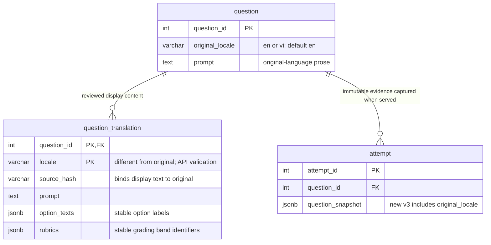

# DBCAS UX and documentation audit — 23 October 2026

**Verdict: PARTIALLY COMPLETE.** The priority authoring simplification and the
safe changes below are implemented. Full PostgreSQL 17 Docker regression and
the complete release browser journeys remain unverified because Docker is
unavailable and WSL connections time out. Supplemental native PostgreSQL 18
checks are explicitly separate. External university originals were reviewed
read-only and remain unchanged; academic document alignment is not complete.

## Baseline and scope

- Maintained repository: `DBCAS`, branch `main`.
- Initial HEAD: `5db597930cb512879ad1b9c577e6e88d33962b47`.
- Initial `git status --short`: empty. The sibling `DBCAS-frontend-src` is not
  the maintained application and was not edited.
- Read `AGENTS.md`, `CONTRIBUTING.md`, README, current operational/user/API
  guides, supervisor R1–R8 notes, requirements decisions and dated reports.
  Traced routes through `App.jsx`, administrator/learner pages, request schemas,
  routers, repositories, localization, evidence capture, graders, validation,
  migration definitions and existing tests. Source review is not a claim that
  every route completed a live browser regression in this environment.
- Searched the authorized workspace outside Git. The four current DBCAS DOCX
  files listed below were extracted read-only, including paragraphs and tables.
  No DOCX/PDF originals were altered. Older backup/rejected copies and the
  unrelated FITAI/SHFA documents are not current DBCAS requirements.

## Complexity findings and disposition

Paths below are repository relative. Baseline findings refer to the initial HEAD.

| ID | Severity | Actual issue and evidence | Disposition |
|---|---|---|---|
| UX01 | P1 | `/admin/questions`: both `AdminQuestionsPage.jsx` and `routers/admin.py:create_question` require VI translation while the main prompt is labeled EN. A Vietnamese original cannot be represented honestly. | Add original-language metadata and allow original-only drafts; one language form and optional reviewed translation. |
| UX02 | P1 | `AdminQuestionsPage.jsx:edit/save` resends every loaded VI translation; `upsert_question_translations` refreshes its hash. Editing original prose could silently approve unchanged translated prose against the new source. | Omit translation writes unless the administrator confirms review. Preserve stale rows and fall back to original content. |
| UX03 | P2 | Question concepts and required concepts are comma-separated numeric IDs; concepts available to the bank filter are derived from existing question rows. | Fetch all concepts; searchable names/codes and required-technique checkboxes with subset-preserving removal. |
| UX04 | P2 | `AdminCurriculumPage.jsx` uses comma-separated IDs for CLO mappings and prerequisites. | Search/select named concepts inside a disclosure; self-prerequisites excluded, pending/rejected AI mappings require explicit review. Existing save and cycle checks preserved. |
| UX05 | P2 | Question difficulty is an unexplained number input. | Labeled Easy 1–2 / Medium 3 / Hard 4–5 choices preserve every numeric level. Exact assessment range controls remain available. |
| UX06 | P2 | Essay authoring requires JSON for rubric criteria and display translations. | Structured criteria and score boundaries; fixed band identifiers. No automatic redistribution of points. Retired three-band historical rubrics remain intact and cannot be validated through the existing gate. |
| UX07 | P2 | MCQ editor allows multiple correct checkboxes and editable label collisions; adding after removing an interior option can repeat a label. | One correct-answer radio group; stable labels; choose an unused label when adding. No default invented answers. |
| UX08 | P2 | No pre-save content preview; save button does not communicate draft lifecycle. | Preview original/reviewed translation with fallback indicator; Save draft and explicit validation guidance. Errors appear beside save controls. |
| UX09 | P2 | SQL dataset JSON has little authoring guidance; reference-answer input is a single line for all formats. | Keep necessary SQL dataset authoring visible with field/edge-case guidance; multiline SQL/essay reference answer; MCQ uses its answer key. Existing hidden MCQ reference metadata is retained on edits. |
| UX10 | P2 | `AdminCandidatesPage.jsx` exposes full JSON for normal candidate review. | Readable options, answer and rubric; full technical payload/datasets in an advanced disclosure. Automated checks and approval remain visible. |
| UX11 | P2 | Candidate/assessment concept selectors show codes only. | Show concept name plus code, preserving API IDs. |
| UX12 | P2 | `PersonalizedAssessment.jsx` exposes the full offered skill list without search. | Search by name/code, retain selected skills in view, show selection count. Required difficulty and format controls stay visible. |
| UX13 | P2 | Exam/evidence language is represented only by HTML `lang`, with no visible explanation when content differs from menus. | Visible content-language notice explaining session pinning. No translation of stored grading narratives. |
| UX14 | P1 documentation | Manual describes every formal session as starting easy and selecting later questions adaptively. Personalized plans are frozen and strictly follow the selected band. | Correct manual; flag conflicting external Architecture/User Story passages for owner revision. |
| UX15 | P3 | Provenance starts expanded during editing although it is secondary to question authoring. | Keep provenance accessible in a closed disclosure. |

No additional P0 was demonstrated. These severities describe the reproduced
authoring problems and source evidence, not an assertion of production incident
counts. No cosmetic theme replacement, dependency addition or CI/CD was introduced.

## Workflow coverage

| Workflow | Source evidence and audit assessment |
|---|---|
| Admin dashboard / analytics | `pages/AdminPage.jsx`, analytics services: cohort and learner drill-down, explicit empty/loading/error states, cumulative and historical review links. Existing behavior retained. |
| Curriculum | `AdminCurriculumPage.jsx`, `curriculum_service.py`, concept graph: named mapping/prerequisite controls replace IDs. Explicit AI decisions, immutable codes and cycle protection retained. |
| Question bank / candidates | `AdminQuestionsPage.jsx`, `QuestionAuthoring.jsx`, `AdminCandidatesPage.jsx`, question/localization/AI services: priority changes above. |
| Assessment creation/publication | `AdminAssessmentsPage.jsx`, `assessment_service.py`, bank validators: concept names clarified; formal mix, range controls, release policy and publication validation retained. |
| Grade verification | `AdminGradingPage.jsx`, `grading_review.py`: review every required SQL/essay, bounded correction, comments on takeover, audit and explicit publication. Required controls were not moved into optional authoring sections. |
| Student accounts / role management | `AdminAccountsPage.jsx`, account/role services and `deps.py`: capability-specific actions, grant/revoke confirmation and restricted provisioning are justified safeguards. No permission changes. |
| Admin settings | Shared `/settings`, `SettingsPage.jsx`: device language/theme and read-only identity are already concise. |
| Registration/login | `LoginPage.jsx`, `RegisterPage.jsx`, auth/OAuth services: labels, validation, password visibility, retry/disabled states and protected role assignment retained. Live OAuth was not exercised. |
| Learner dashboard | `DashboardPage.jsx`: published session evidence, explicit pending/empty/error states, charts and guidance. Existing component regressions run; complete live route tour still pending. |
| Assessment / skill / difficulty | `AssessmentsPage.jsx`, `PersonalizedAssessment.jsx`, personalized assembler: search added; required skills, band, practice length/formal format and release explanation remain. Both legacy adaptive and personalized entry paths exist. |
| Exam / answers / submission wait | `ExamPage.jsx`, SQL editor, draft/lifecycle services: visible content language added. Autosave, forward-only serving, run/submit distinction, finish confirmation and grading wait retained. |
| Results / competency / gaps / history | `EvidencePage.jsx`, `CumulativePage.jsx`, `HistoryPage.jsx`, competency/guidance/review services: fixed historical content language visible; publication guards, official evidence and deterministic formulas retained. |
| Learner settings | Shared `SettingsPage.jsx`: UI language/theme does not relabel authored content or change a session's evidence. |

## Bilingual contract and safety

`question.original_locale` is `en` or `vi`. The existing neutral `prompt`,
`mcq_option.option_text`, explanation and rubric criteria now mean original
prose in that explicitly stored language. They are not falsely labeled English.
The API defaults new omitted locale to `en`; an update omitting it preserves the
stored value. An explicit relabel is rejected. Existing records default to English.

`question_translation` retains its existing composite key, source hash and
type-specific display payload. English translations are now allowed for
Vietnamese originals. Administrator submission is the existing reviewed-content
write boundary. The editor requires an explicit review checkbox before sending
translation changes; no AI translation, draft provider content or fake text is
generated. Duplicate or source-language translation locales are rejected.

Missing/stale translations display the original and its actual `content_locale`.
The bank lists original language and current translation locales. Original prose
edits preserve old translated text and make it stale until explicitly reviewed.
English-source fingerprints retain the previous serialization exactly. The
checked-in English benchmark packs and their mandatory VI manifests keep their
separate existing completeness contract and were not changed.

New question snapshots use version 3 and include `original_locale`. Versions 1–2
without it remain English. New reads of old evidence never rewrite the stored
snapshot. Grading reads the original snapshot; a display translation is not an
alternative grading rubric. English rubric band identifiers, points, score
ranges, correct-option identity, SQL syntax/identifiers/datasets/expected rows,
concept weights and release guards remain authoritative and unchanged.

The current academic documents explicitly pin assessment content locale. That
rule is preserved even when menus switch language. The question preview can
switch its display language; active assessments and history retain their pinned
content and grading evidence. Changing that academic behavior is not implied by
changing menu language. The user-requested Vietnamese-original extension is
recorded here rather than silently rewriting the external English-source claims.

### Schema excerpt after migration 012

No new domain table is introduced. Existing entities and relationships remain:



This is an affected-entity excerpt, not a replacement for the complete database
design. `db/schema.sql` includes the same additive SQL as migration 012. Migrations
001–011 are untouched. Migration 012 changes the obsolete English-exclusion
constraint while retaining locale-format validation and existing translation rows.
No upgrade was applied to persistent development data. An operator must verify a
restorable backup and obtain explicit owner authorization before that upgrade.

## Documentation traceability

Statuses refer to the final source contract; OUTDATED external passages remain
unmodified. NOT VERIFIED means source agreement alone does not establish runtime
or release acceptance. Missing documents are explicitly NOT REVIEWED.

| Document | Requirement or claim | Actual code evidence | Status | Action |
|---|---|---|---|---|
| `README.md` | Stack, separate sandbox, local gates, setup | package manifests, Compose, `app/main.py`, test harness | MATCH / runtime NOT VERIFIED | Add original-language behavior and migration 012 link; retain local-only gates. |
| `CONTRIBUTING.md`, `AGENTS.md` | Attribution, no university binaries in Git | Initial tree and final changes | MATCH | Read; no commit or push. |
| `docs/setup-and-migrations.md` | Additive upgrades, separate databases, reviewed pack import | `migrate.py`, migrations, `benchmark.py` | MATCH | Add 012 and backup/authorization boundary. Pack completeness remains unchanged. |
| `docs/learner-and-admin-manual.md` | Both languages shown, English fallback; all sessions adapt | question editor, localization, personalized assembler | MATCH after correction | Replace workflows with single-language authoring, reviewed translation, named curriculum controls, preview and accurate session distinctions. |
| `docs/api-conventions.md`; generated FastAPI OpenAPI | Question payload, locale, evidence, RBAC | `schemas.py`, `routers/admin.py`, localization/evidence services | MATCH after correction | Add `original_locale`, omission rules, reviewed translation examples, source fallback and snapshot v3. No separate checked-in OpenAPI specification was found. |
| `docs/supervisor-implementation.md` | R1–R8; dated test counts and historical implementation | selection, grading review, competency services and tests | MATCH for retained requirements; current full gate NOT VERIFIED | Add dated authoring amendment; preserve earlier results as historical. |
| `docs/requirements-decisions.md` | SELECT-only SQL and conceptual DML/DDL; preserve old assessment 2 | SQL validator/sandbox and versioned assessment templates | MATCH | No change to the approved decision. Proposal 1.5 already incorporates this scope. |
| Proposal `C1SE.70_ProposalDocument_DBCAS_ver1.5.docx` | FR-06/07 personalized plans, 60 minutes/10–2–1, bilingual UI; SELECT-only scope | personalized assembler, assessment constants, sandbox and UI | MATCH by source; full regression NOT VERIFIED | Read-only review. No point-weight or scope changes. |
| User Stories `C1SE.70_UserStoryDocument_DBCAS_ver1.4.docx` | Admin 5 says English canonical plus optional VI | new `original_locale` and English translation support | OUTDATED for authoring extension | Owner should update Admin 5 to explicit original language and optional other-language translation. Original file untouched. |
| Same User Stories | Learner 3 universal easy openings versus Learner 4 frozen selected band | legacy adaptive engine vs personalized assembler | OUTDATED / ambiguous | Owner should scope easy openings to the legacy adaptive path. Manual corrected without rewriting the requirement document. |
| Architecture `C1SE.70_ArchitectureDesign_DBCAS_ver1.3.docx` | UC07 rejects translations targeting English; English canonical | translation validation now compares original locale | OUTDATED | Owner should revise UC07 primary/alternate flows for the additive language extension. |
| Same Architecture | UC12 step 4 says formal sessions open easy and adapt from a frozen plan | `personalized_assessment.py` freezes exact band; legacy adaptive engine is separate | OUTDATED | Record discrepancy; preserve R2/R3 and existing difficulty semantics. |
| Same Architecture | Session locale fixed; read-only sandbox; verified release | session locale trigger, SQL runner, grading review | MATCH by source | Preserve; do not silently change pinned evidence language. |
| Database Design `C1SE.70_DatabaseDesign_DBCAS_ver1.4.docx` | Question table and QuestionTranslation table 28 assume English source and non-English locale | migration 012, models, schema | OUTDATED | Owner should add `original_locale`, update locale/hash descriptions and affected diagrams. Repository schema excerpt above supplies the precise delta. |
| UI Design, DBCAS formal Test Plan/Test Cases, current university Test Report, standalone formal SRS | Files not found in the authorized workspace | Workspace inventory; FITAI/SHFA files belong to another project | MISSING — NOT REVIEWED | Do not fabricate them or claim full academic alignment. User Stories reviewed as the available requirements artifact. |
| `docs/testing-and-release-gates.md` | Disposable Docker, no live providers, local release checks | conftest, release server, Playwright configs | MATCH; full gate NOT VERIFIED | Add new regression commands; keep PostgreSQL 17 requirement and existing scripts. |
| `docs/deployment-and-readiness.md` | Separate deployment stack, upgrade before startup | release Compose, readiness repository | MATCH by source | Add 012 prerequisite and owner authorization/verified backup instruction. No deployment performed. |
| `docs/bilingual-question-verification.md` | 15 October checkpoint | Historical report, subsequently superseded legacy decision | MATCH as historical evidence | Add dated amendment pointing here. Do not change old counts/results. |
| `docs/core-question-recovery.md`, `legacy-essay-resolution.md`, `pg-m089-assessment-2-reconciliation.md`, remediation records | Recovery, rejected rubric conversion and dated acceptance facts | source packs, reconciliation and retired legacy record tests | Historical; current runtime NOT VERIFIED | Preserve original facts. These are not fresh regression evidence for this working tree. |

Exact corrected current guides: README, manual, API conventions, setup,
deployment/readiness, testing/release gates. Dated amendments only: supervisor
implementation and bilingual verification. This report is new. University DOCX
originals and existing historical images/reports are unchanged. New viewport
screenshots are private local verification artifacts under the workspace's
`_review/ux-native-browser`, outside Git.

## R1–R8 preservation

| Requirement | Retained implementation |
|---|---|
| R1 skill selection | One/multiple/all offered skills; search changes presentation only. Exact selected IDs reach the existing assembler. |
| R2 difficulty | Easy 1–2 / Medium 3 / Hard 4–5; retain exact 1–5 bank levels and assessment ranges. |
| R3 personalization | Frozen approved-bank plan, coverage, quotas, family deduplication and idempotent start unchanged. |
| R4 classification | Confirmed concepts, required techniques, difficulty and serving validation retained. |
| R5 release | Existing Immediate/Human verified policy and learner publication guards unchanged. |
| R6 human review | Required SQL/essay verification, bounded correction, explicit publication and audits unchanged. |
| R7 cumulative competency | Published evidence and approved point-weighted computation unchanged. |
| R8 concept metadata | Description, SQL feature, keywords, learning objectives, CLO links and prerequisites retained. |

## Regression results

### Final commands and outcomes

Environment: Windows; Node 24.16.0, npm 11.13.0, backend virtual environment
Python 3.14.5. Supplemental databases: native PostgreSQL 18.4 on private,
random loopback ports. These are not the project's Python 3.13 / PostgreSQL 17
Docker release environment.

| Command and working directory | Actual outcome |
|---|---|
| `npm.cmd test -- --reporter=json --outputFile=../../_review/ux-vitest-final.json` in `frontend` | 238/238 tests passed; 0 failures; 32 files. |
| `npm.cmd run build` in `frontend` | PASS; existing >500 kB chunk warning. |
| `.venv/Scripts/python.exe -m compileall -q app tests` in `backend` | PASS. |
| `.venv/Scripts/python.exe -m pytest -q` in `backend` | BLOCKED before test execution: conftest requires Docker. No backend suite pass is claimed. |
| `npm.cmd run test:e2e -- question-authoring.spec.js` in `frontend` | BLOCKED: release server cannot initialize required Docker fixtures. |
| `.\DBCAS\backend\.venv\Scripts\python.exe _review/ux_native_regression.py` from workspace root | Supplemental only: 32/32 direct regression function calls passed; 0 failed. Includes five existing RBAC/role checks, five migration cases, original-language APIs, sessions, version forks and mocked essay grading. This is not a pytest run or a substitute for the full backend gate. |
| `.\DBCAS\backend\.venv\Scripts\python.exe _review/ux_native_browser.py` from workspace root | Supplemental only: 7 Chromium journeys passed, 0 failed, 0 skipped; real app entrypoint, new PG18 fixture database, disabled providers. |
| `.\DBCAS\backend\.venv\Scripts\python.exe DBCAS/db/validate_question_localization.py` from workspace root | PASS: 442/442 source questions, 326 MCQ / 67 SQL / 49 essay; no missing translations, duplicate keys or integrity errors. Static bank check; SQL execution not claimed. |
| `py _review/ux_check_links.py` from workspace root | PASS: 17 Markdown documents, 30 local links including 3 anchors; no broken local links. External URLs not checked. |
| Catalog parity | PASS: 1001 English/Vietnamese leaf keys each. |
| `git diff --check` | PASS. |

The seven supplemental browser journeys cover both original-only MCQ languages,
reviewed translation and stale edit behavior, four viewport widths with axe,
named curriculum mappings/prerequisites, Vietnamese SQL identifiers/fixtures,
and structured Vietnamese essay criteria. Axe reported zero violations for
the checked question editor; this is not application-wide WCAG certification.
Screenshots and browser diagnostics remain outside Git.

Initial runs exposed old-label fixtures, a preview locator matching both input
and preview, an incorrect SQL-dataset locator, and one new component test
exceeding the default five-second deadline under parallel load. Fixtures and
locators were corrected; bulk field changes in that component test now use
direct change events while browser journeys exercise the actual editor. Final
full frontend and supplemental browser reruns pass without retry settings.
One standard browser attempt also encountered occupied ports while the native
fixture was active; the later sequential standard attempt reproduced the Docker
blocker. No failed or blocked release gate is counted as passing.

The first native launcher needed file-backed subprocess output to avoid Windows
inherited-pipe waits, and its first browser fixture attempted to reseed existing
reference roles. These fixture issues were corrected outside the repository;
owned clusters were stopped. Standard conftest, Docker setup and release scripts
were not weakened. No live external AI provider was called. The initial native
independent-edit assertion also compared a mutated expected dictionary; it now
compares the captured original text directly, alongside a real database version
fork/snapshot preservation test.

Full SQL sandbox, assessment assembly, grading/publication and Firefox/WebKit
release journeys remain NOT VERIFIED for this revision. Their source contracts
are retained, and the existing frontend regressions cover their presentation.

### Final Git and data state

HEAD remains `5db597930cb512879ad1b9c577e6e88d33962b47` on `main`.
Repository changes: **34 modified tracked files, 6 new files, 0 deleted files**.
No commit, push, reset, clean, merge or deployment was performed. No GitHub Actions
or hosted pipeline was introduced. No persistent migration or learner-submission
write was performed; all write checks used newly created disposable fixture data.
The external university originals remain unchanged. Supplemental launchers,
logs, extracted read-only text and screenshots live outside the repository under
the authorized workspace. Applied migrations 001–011 and checked-in bank packs
have no diff.

Exact repository status:

```text
 M README.md
 M backend/app/models.py
 M backend/app/repositories.py
 M backend/app/routers/admin.py
 M backend/app/schemas.py
 M backend/app/services/adaptive_engine.py
 M backend/app/services/evidence_context.py
 M backend/app/services/question_localization.py
 M backend/app/services/question_service.py
 M backend/tests/test_admin_questions.py
 M backend/tests/test_migrations.py
 M db/schema.sql
 M docs/api-conventions.md
 M docs/bilingual-question-verification.md
 M docs/deployment-and-readiness.md
 M docs/learner-and-admin-manual.md
 M docs/setup-and-migrations.md
 M docs/supervisor-implementation.md
 M docs/testing-and-release-gates.md
 M frontend/e2e/release.spec.js
 M frontend/src/components/PersonalizedAssessment.jsx
 M frontend/src/i18n/en.json
 M frontend/src/i18n/vi.json
 M frontend/src/pages/EvidencePage.jsx
 M frontend/src/pages/ExamPage.jsx
 M frontend/src/pages/admin/AdminAssessmentsPage.jsx
 M frontend/src/pages/admin/AdminCandidatesPage.jsx
 M frontend/src/pages/admin/AdminCurriculumPage.jsx
 M frontend/src/pages/admin/AdminQuestionsPage.jsx
 M frontend/src/test/AdminManagement.test.jsx
 M frontend/src/test/BankControls.test.jsx
 M frontend/src/test/CurriculumEditing.test.jsx
 M frontend/src/test/LocalizedWorkspaces.test.jsx
 M frontend/src/test/SupervisorWorkflows.test.jsx
?? backend/tests/test_question_original_locale.py
?? db/migrations/012_question_original_locale.sql
?? docs/ux-simplification-audit-20261023.md
?? frontend/e2e/question-authoring.spec.js
?? frontend/src/components/QuestionAuthoring.jsx
?? frontend/src/test/QuestionAuthoring.test.jsx
```

## Remaining issues and final UX assessment

1. Full backend/PostgreSQL 17 Docker, real sandbox execution and complete release
   browser suites must run once Docker/WSL is available. Native PostgreSQL 18
   checks are supplemental; no release approval is inferred from them.
2. Three reviewed university documents (User Stories, Architecture and Database
   Design) need the specific owner revisions in the matrix. The Proposal's
   relevant claims match the source. Missing DBCAS university deliverables remain
   NOT REVIEWED.
3. SQL dataset creation remains JSON for technical dataset authors. This is
   explicit required configuration, with guidance and sandbox validation; a full
   visual dataset builder is outside this focused change.
4. Learners still see both personalized and original adaptive entry paths in
   Assessments. They perform different supported selection behaviors; merging
   them requires an academic/product decision about the legacy adaptive path.
5. Existing build chunk-size, Starlette/httpx deprecation and jsdom `scrollTo`
   notices are recorded with verification; they are not hidden test failures.

A first-time administrator can now create a question in one language without
fabricating a second, choose concepts by name, select one MCQ key, author essay
criteria without JSON, preview, save a draft and follow validation guidance.
Curriculum editing and candidate review expose less internal representation.
Learners can search skills and understand content language while keeping required
assessment decisions. End-to-end simplification of every major learner/admin
journey cannot be certified until the full blocked regression is completed.


## 23 October 2026 follow-up

[Follow-up checkpoint: bilingual display behavior, faithful diagrams and current regression](bilingual-architecture-completion-20261023.md). Earlier dated observations and test results remain historical;
the follow-up records subsequent changes and unresolved gates.
